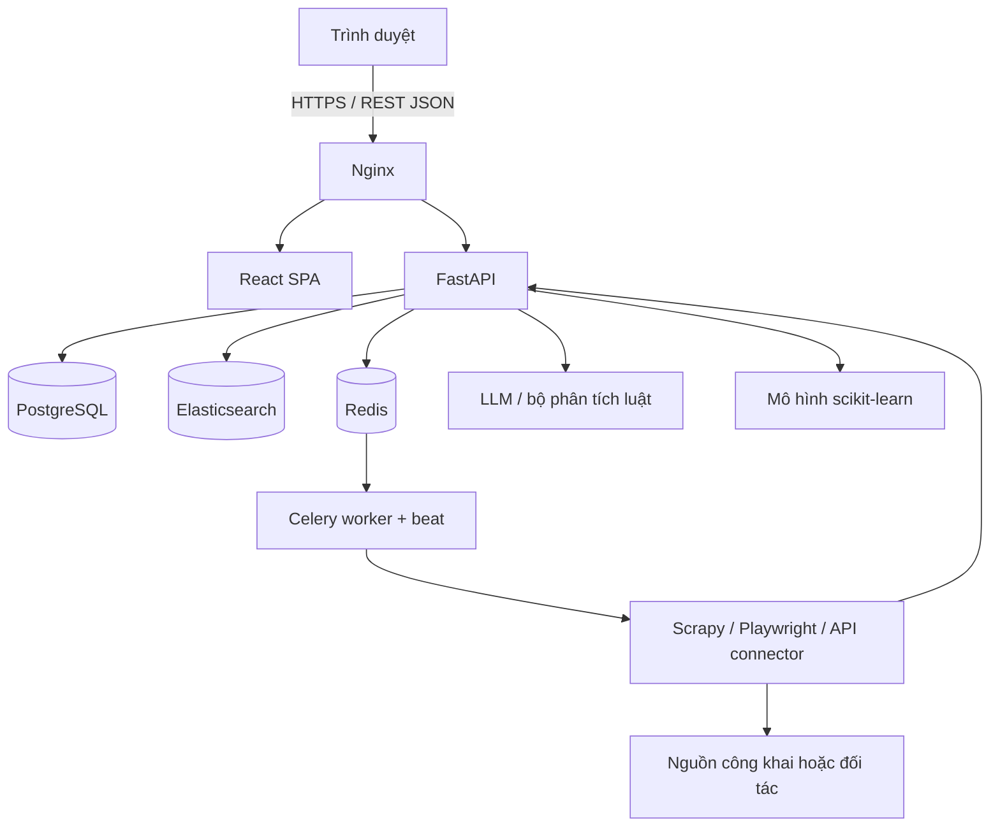

<p align="center">
  
</p>

# Phòng Ơi — Nền tảng tìm phòng trọ Đà Nẵng ứng dụng AI

Phòng Ơi là hệ thống tổng hợp, chuẩn hóa và phân tích tin đăng phòng trọ dành cho sinh viên tại Đà Nẵng. Ứng dụng hỗ trợ tìm kiếm bằng tiếng Việt tự nhiên, xem phòng trên OpenStreetMap, gợi ý theo nhu cầu, đánh giá giá thuê và rủi ro, đồng thời cung cấp khu vực quản trị nguồn thu thập, pipeline dữ liệu và kiểm duyệt nội dung.

Đây là mã nguồn đề tài nghiên cứu khoa học sinh viên: **“Nghiên cứu và xây dựng hệ thống tổng hợp, phân tích tin đăng phòng trọ ứng dụng trí tuệ nhân tạo hỗ trợ tìm kiếm và gợi ý phòng trọ phù hợp cho sinh viên.”**

## Mục lục

- [Chức năng chính](#chức-năng-chính)
- [Kiến trúc hệ thống](#kiến-trúc-hệ-thống)
- [Công nghệ sử dụng](#công-nghệ-sử-dụng)
- [Cấu trúc mã nguồn](#cấu-trúc-mã-nguồn)
- [Chạy nhanh bằng Docker](#chạy-nhanh-bằng-docker)
- [Chạy môi trường phát triển](#chạy-môi-trường-phát-triển)
- [Khởi tạo tài khoản quản trị](#khởi-tạo-tài-khoản-quản-trị)
- [Cấu hình môi trường](#cấu-hình-môi-trường)
- [Thu thập dữ liệu thật](#thu-thập-dữ-liệu-thật)
- [AI, tìm kiếm và máy học](#ai-tìm-kiếm-và-máy-học)
- [RESTful API](#restful-api)
- [Kiểm thử](#kiểm-thử)
- [Triển khai và vận hành](#triển-khai-và-vận-hành)
- [Bảo mật](#bảo-mật)
- [Xử lý lỗi thường gặp](#xử-lý-lỗi-thường-gặp)

## Chức năng chính

### Sinh viên và khách truy cập

- Xem danh sách, chi tiết và vị trí phòng trọ trên bản đồ OpenStreetMap.
- Tìm theo giá, diện tích, quận, loại phòng, tiện ích, trường học và khoảng cách.
- Nhập câu tiếng Việt tự nhiên, ví dụ: “Tìm phòng dưới 3 triệu gần Đại học Bách khoa, có máy lạnh”.
- Xem phân tích giá, chi phí hàng tháng, chất lượng tin, dấu hiệu rủi ro và nguồn gốc dữ liệu.
- Tạo hồ sơ nhu cầu, nhận gợi ý, lưu tin, so sánh phòng và quản lý thông báo.
- Báo cáo tin sai, tin đã cho thuê, tin trùng hoặc có dấu hiệu lừa đảo.
- Xuất dữ liệu cá nhân và yêu cầu xóa tài khoản.

### Chủ trọ

- Đăng, sửa, làm mới và quản lý trạng thái phòng.
- Tải nhiều ảnh và dùng AI hỗ trợ điền thông tin từ mô tả.
- Kiểm tra khoảng giá đề xuất theo khu vực.
- Theo dõi lượt hiển thị, lượt xem, lượt liên hệ và tỷ lệ chuyển đổi.
- Quản lý hồ sơ chủ trọ và thông tin xác minh.

### Quản trị viên

- Theo dõi tổng quan hệ thống, nguồn dữ liệu, lượt crawl và pipeline xử lý.
- Quản lý registry nguồn, selector, lịch chạy, giới hạn tốc độ và tình trạng sức khỏe.
- Phê duyệt điều khoản/robots.txt trước khi bật nguồn bên thứ ba.
- Chạy nguồn đơn lẻ hoặc toàn bộ nguồn đủ điều kiện.
- Kiểm duyệt tin, xử lý báo cáo vi phạm và quản lý danh mục.
- Theo dõi ngân sách, lượt gọi và chi phí AI.
- Quản lý cookie phiên Facebook ở phía máy chủ; dữ liệu cookie không được đưa vào Git.

## Kiến trúc hệ thống



Luồng dữ liệu chính:

1. Nguồn đã được cấu hình và phê duyệt được worker đưa vào lịch chạy.
2. Connector thu thập dữ liệu theo robots.txt, rate limit và chính sách URL an toàn.
3. Backend làm sạch, trích xuất trường, chuẩn hóa, gộp trùng, chấm điểm chất lượng/rủi ro và lưu nguồn gốc.
4. Tin hợp lệ được lưu trong PostgreSQL và lập chỉ mục Elasticsearch.
5. API cung cấp dữ liệu cho tìm kiếm, bản đồ, gợi ý, quản trị và thống kê.

## Công nghệ sử dụng

### Frontend

| Công nghệ | Phiên bản | Vai trò |
|---|---:|---|
| React | 18.3.1 | Xây dựng giao diện theo component |
| TypeScript | 5.6.3 | Kiểm tra kiểu tĩnh |
| Vite | 7.3.x | Dev server và production build |
| React Router DOM | 7.18.x | Điều hướng và bảo vệ route theo vai trò |
| TanStack Query | 5.62.0 | Fetch, cache và đồng bộ trạng thái server |
| Tailwind CSS | 3.4.15 | Hệ thống style responsive và dark mode |
| Leaflet / React Leaflet | 1.9.4 / 4.2.1 | Bản đồ tương tác |
| OpenStreetMap | Dịch vụ bản đồ | Tile bản đồ cơ bản, không yêu cầu API key |
| Recharts | 2.13.3 | Biểu đồ dashboard và thị trường |
| Framer Motion | 11.11.17 | Chuyển động giao diện |
| Lucide React | 0.460.0 | Bộ biểu tượng |
| clsx | 2.1.1 | Ghép class có điều kiện |

### Backend và API

| Công nghệ | Phiên bản | Vai trò |
|---|---:|---|
| Python | 3.11 | Runtime backend, crawler và ML |
| FastAPI | 0.115.6 | RESTful API bất đồng bộ, OpenAPI/Swagger |
| Uvicorn | 0.32.1 | ASGI server |
| Pydantic / pydantic-settings | 2.10.3 / 2.6.1 | Schema, kiểm tra dữ liệu và cấu hình |
| SQLAlchemy | 2.0.36 | ORM và truy vấn dữ liệu |
| Alembic | 1.14.0 | Migration cơ sở dữ liệu |
| PyJWT | 2.10.1 | Xác thực JWT |
| bcrypt | 4.2.1 | Băm mật khẩu |
| HTTPX | 0.28.1 | HTTP client cho connector và dịch vụ ngoài |
| python-multipart | 0.0.19 | Upload ảnh/form-data |

### Dữ liệu, tìm kiếm và xử lý nền

| Công nghệ | Phiên bản | Vai trò |
|---|---:|---|
| PostgreSQL | 16 | Cơ sở dữ liệu production |
| SQLite | Python built-in | Cơ sở dữ liệu gọn cho phát triển/test |
| Elasticsearch | 8.15.x | Full-text tiếng Việt, bộ lọc và truy vấn địa lý |
| Redis | 7 | Broker/cache cho tác vụ nền |
| Celery | 5.4.0 | Worker xử lý crawl, pipeline và lịch định kỳ |
| Kombu | 5.6.2 | Messaging layer của Celery |

### Thu thập dữ liệu

| Công nghệ | Phiên bản | Vai trò |
|---|---:|---|
| Scrapy | 2.19.0 | Crawl trang HTML tĩnh |
| Playwright / scrapy-playwright | 0.0.48 | Nguồn cần trình duyệt động |
| Connector REST/API | Nội bộ | Nhận JSON/feed chính thức |
| Webhook, CSV/XLSX, nhập thủ công | Nội bộ | Kênh dữ liệu chính chủ và đối tác |

Registry hiện có **102 profile nguồn** gồm nguồn chính chủ, API/feed, HTML tĩnh, Playwright và nguồn cộng đồng. Profile chỉ là cấu hình khởi đầu; nguồn bên thứ ba vẫn phải được kiểm tra pháp lý, robots.txt, selector và khả năng truy cập trước khi chạy.

### AI và máy học

| Công nghệ | Phiên bản/nhà cung cấp | Vai trò |
|---|---|---|
| Ollama | Cấu hình được | Chạy LLM cục bộ, mặc định mẫu `qwen3:4b` |
| Gemini | API chính thức | Phân tích truy vấn/trích xuất dữ liệu tùy chọn |
| OpenAI-compatible API | OpenAI, Groq, OpenRouter... | LLM online thông qua endpoint tương thích |
| scikit-learn | 1.5.2 | Mô hình dự đoán giá và phân loại bài đăng |
| joblib | 1.4.2 | Lưu/nạp mô hình ML |
| Bộ phân tích luật tiếng Việt | Nội bộ | Fallback khi LLM tắt, lỗi hoặc trả dữ liệu sai schema |

### DevOps và kiểm thử

| Công nghệ | Phiên bản | Vai trò |
|---|---:|---|
| Docker Compose | Compose v2 | Chạy đồng bộ toàn hệ thống |
| Docker | Hiện hành | Đóng gói dịch vụ |
| Nginx | 1.27 Alpine | Phục vụ React SPA và reverse proxy `/api` |
| Node.js | 22 trong Docker | Build frontend |
| pytest | 8.3.4 | Unit/integration test backend |
| Vitest | 5.x | Unit/component test frontend |
| Testing Library / jest-dom | 16.1 / 6.6 | Kiểm thử hành vi component |
| jsdom | 25.x | Môi trường DOM cho Vitest |
| Playwright + Python | Tùy môi trường | Smoke test trình duyệt end-to-end |

## Cấu trúc mã nguồn

```text
phongoi/
├── backend/
│   ├── app/                 # FastAPI, ORM, tìm kiếm, AI, pipeline, worker
│   ├── alembic/             # Migration database
│   ├── scripts/             # Audit/chuẩn hóa dữ liệu nguồn
│   ├── tests/               # Test backend
│   ├── models/              # Mô hình ML đã huấn luyện
│   └── Dockerfile
├── crawler/
│   ├── phongoi_crawler/     # Spider, pipeline và kiểm tra URL an toàn
│   ├── source_profiles.json # Registry profile nguồn
│   └── fixtures/            # Fixture chỉ dành cho test/demo
├── frontend/
│   ├── src/components/      # Component dùng chung
│   ├── src/pages/           # Trang public, sinh viên, chủ trọ, admin
│   ├── src/lib/             # API client, auth, types, theme
│   ├── public/              # Logo và tài nguyên tĩnh
│   └── Dockerfile
├── ml/                      # Script huấn luyện mô hình
├── e2e/                     # Smoke test trình duyệt
├── docs/                    # Báo cáo và tài liệu nghiên cứu
├── docker-compose.yml
└── README.md
```

## Chạy nhanh bằng Docker

### 1. Yêu cầu

- Git.
- Docker Desktop hoặc Docker Engine + Docker Compose v2.
- Tối thiểu khoảng 4 GB RAM trống; Elasticsearch được cấu hình heap 1 GB tổng cộng.
- Ollama là tùy chọn nếu muốn chạy LLM cục bộ.

### 2. Tải mã nguồn

```bash
git clone https://github.com/devvd25/phongoi.git
cd phongoi
```

### 3. Tạo cấu hình production cục bộ

Windows PowerShell:

```powershell
Copy-Item .env.docker.example .env.docker
python -c "import secrets; print(secrets.token_hex(32)); print(secrets.token_hex(32))"
```

macOS/Linux:

```bash
cp .env.docker.example .env.docker
python3 -c "import secrets; print(secrets.token_hex(32)); print(secrets.token_hex(32))"
```

Dán hai chuỗi sinh ra vào `JWT_SECRET` và `INGEST_TOKEN` trong `.env.docker`. Hai giá trị phải khác nhau, dài ít nhất 32 ký tự và không được commit.

Nếu dùng Gemini/OpenAI/Ollama, sao chép cấu hình backend rồi điền biến phù hợp:

```powershell
Copy-Item backend/.env.example backend/.env
```

### 4. Khởi động

```bash
docker compose up -d --build
docker compose ps
```

| Dịch vụ | Địa chỉ |
|---|---|
| Website | http://localhost:8080 |
| API | http://localhost:8000 |
| Swagger UI | http://localhost:8000/docs |
| OpenAPI JSON | http://localhost:8000/openapi.json |
| Health check | http://localhost:8000/api/health |

Xem log:

```bash
docker compose logs -f api worker beat web
```

Dừng hệ thống nhưng giữ dữ liệu:

```bash
docker compose down
```

Xóa toàn bộ volume dữ liệu Docker chỉ khi thực sự muốn làm lại từ đầu:

```bash
docker compose down -v
```

> **Cảnh báo:** `down -v` xóa PostgreSQL, Elasticsearch, Redis và uploads trong volume Docker.

## Chạy môi trường phát triển

### Backend

Yêu cầu Python 3.11.

Windows PowerShell:

```powershell
cd backend
python -m venv .venv
.\.venv\Scripts\Activate.ps1
python -m pip install --upgrade pip
pip install -r requirements.txt
Copy-Item .env.example .env
alembic upgrade head
python -m uvicorn app.main:app --reload --port 8000
```

macOS/Linux:

```bash
cd backend
python3.11 -m venv .venv
source .venv/bin/activate
python -m pip install --upgrade pip
pip install -r requirements.txt
cp .env.example .env
alembic upgrade head
python -m uvicorn app.main:app --reload --port 8000
```

Mặc định backend local dùng SQLite và có thể chạy không cần Elasticsearch/Redis. Khi Elasticsearch không sẵn sàng, tìm kiếm fallback về SQL; khi Redis trống, các tác vụ phù hợp có thể chạy đồng bộ.

### Frontend

Yêu cầu Node.js 20+, khuyến nghị Node.js 22.

```bash
cd frontend
npm ci
npm run dev
```

Vite chạy tại http://localhost:5173 và proxy `/api` sang backend cổng 8000.

### Playwright cho nguồn động

```bash
cd backend
python -m playwright install chromium
```

## Khởi tạo tài khoản quản trị

Hệ thống không đưa tài khoản/mật khẩu thật vào Git. Với database mới và dữ liệu thật:

1. Mở website, đăng ký một tài khoản bằng email của quản trị viên.
2. Nâng vai trò tài khoản trong PostgreSQL:

```bash
docker compose exec postgres psql -U phongoi -d phongoi -c "UPDATE users SET role='admin' WHERE email='admin@example.com';"
```

3. Đăng xuất và đăng nhập lại để JWT nhận vai trò mới.
4. Vào **Admin → Nguồn thu thập → Đồng bộ registry** rồi chỉ bật các nguồn đã kiểm tra.

### Dữ liệu demo dành cho phát triển

```bash
cd backend
python -m app.seed
```

> **Cảnh báo nghiêm trọng:** `python -m app.seed` xóa và tạo lại schema trước khi sinh dữ liệu mẫu. Không chạy lệnh này trên database đang chứa dữ liệu thật hoặc production.

## Cấu hình môi trường

Các biến chính nằm trong `backend/.env.example`:

| Biến | Mặc định mẫu | Mục đích |
|---|---|---|
| `APP_ENV` | `development` | `development` hoặc `production` |
| `APP_URL` | `http://localhost:5173` | URL frontend dùng trong email |
| `DATABASE_URL` | SQLite | Kết nối PostgreSQL/SQLite |
| `ELASTICSEARCH_URL` | trống | Endpoint Elasticsearch |
| `REDIS_URL` | trống | Redis broker/cache |
| `JWT_SECRET` | giá trị mẫu | Ký JWT; production tối thiểu 32 ký tự |
| `INGEST_TOKEN` | giá trị mẫu | Xác thực crawler ingest; phải khác JWT secret |
| `LLM_PROVIDER` | `ollama` trong file mẫu | `ollama`, `gemini`, `openai` hoặc `none` |
| `OLLAMA_URL` | `http://localhost:11434` | Endpoint Ollama |
| `OLLAMA_MODEL` | `qwen3:4b` | Mô hình Ollama |
| `GEMINI_API_KEY` | trống | Một hoặc nhiều key Gemini, cách nhau bằng dấu phẩy |
| `GEMINI_MODEL` | `gemini-2.5-flash` | Mô hình Gemini |
| `OPENAI_API_KEY` | trống | Key API tương thích OpenAI |
| `OPENAI_BASE_URL` | OpenAI | Endpoint OpenAI/Groq/OpenRouter |
| `OPENAI_MODEL` | `gpt-4o-mini` | Tên mô hình tương ứng |
| `SMTP_HOST`, `SMTP_PORT` | trống / 587 | Máy chủ gửi email |
| `SMTP_USER`, `SMTP_PASSWORD` | trống | Tài khoản SMTP |
| `CORS_ORIGINS` | localhost | Danh sách origin frontend |
| `FB_STORAGE_STATE_PATH` | `cookies/fb-auth.json` | Cookie storage state của Facebook bot |
| `FB_PROXY_URL` | trống | Proxy tùy chọn cho Facebook bot |

Trong production, backend từ chối khởi động nếu `JWT_SECRET`/`INGEST_TOKEN` yếu, giống nhau hoặc còn giữ giá trị mẫu.

## Thu thập dữ liệu thật

### Nguyên tắc vận hành

- Chỉ thu thập nguồn có quyền truy cập phù hợp và đã kiểm tra điều khoản sử dụng.
- Luôn tôn trọng robots.txt, giới hạn tốc độ và chính sách của từng miền.
- Nguồn mới mặc định không được chạy tự động cho đến khi có cấu hình/phê duyệt cần thiết.
- URL được kiểm tra để chặn localhost, private IP, credential trong URL và redirect không an toàn.
- Nguồn lỗi liên tiếp bị giảm điểm sức khỏe và có thể tự tạm dừng.
- Chỉ đưa tin vượt qua làm sạch, trích xuất, gộp trùng và kiểm tra chất lượng vào dữ liệu sử dụng.

### Đồng bộ registry

Thực hiện tại **Admin → Nguồn thu thập → Đồng bộ registry**. Thao tác đồng bộ idempotent và không ghi đè cấu hình/phê duyệt hiện có.

### Audit nguồn không tải nội dung

```bash
cd backend
python -m scripts.audit_sources
```

### Chạy spider thủ công

```bash
cd crawler
scrapy crawl generic -a start_url=https://example.com/phong-tro \
  -a item_selector=.listing-item \
  -a detail_link_selector="a::attr(href)"
```

Crawler gửi item về `/api/admin/ingest` bằng `INGEST_TOKEN`. Không đưa token thật vào source code hoặc command history dùng chung.

### Facebook Group Bot

- Cookie storage state được lưu trong `cookies/` và đã bị loại khỏi Git.
- Cookie là thông tin xác thực nhạy cảm; chỉ nhập qua giao diện quản trị hoặc máy chủ tin cậy.
- Facebook có thể thay đổi DOM, checkpoint hoặc chính sách; cần theo dõi log và cập nhật selector định kỳ.

## AI, tìm kiếm và máy học

### Tìm kiếm ngôn ngữ tự nhiên

1. LLM hoặc bộ phân tích luật chuyển câu tiếng Việt thành bộ lọc có cấu trúc.
2. Pydantic kiểm tra kiểu và phạm vi giá trị.
3. Luật kiểm chứng đối chiếu giá, diện tích, quận, trường và tiện ích với câu gốc.
4. Search service truy vấn Elasticsearch hoặc fallback SQL.
5. Kết quả được xếp hạng theo mức phù hợp, chất lượng và rủi ro.

LLM chỉ đề xuất dữ liệu; backend là lớp quyết định cuối cùng. Nếu LLM lỗi, timeout hoặc trả JSON sai, hệ thống dùng bộ phân tích luật.

### Huấn luyện mô hình

```bash
cd backend
python ../ml/train_price_model.py
python ../ml/train_post_classifier.py
```

Mô hình được lưu trong `backend/models/`. Khi thay dữ liệu huấn luyện cần ghi nhận nguồn, phiên bản dữ liệu và chỉ số đánh giá để tránh dùng dữ liệu demo làm kết quả nghiên cứu.

## RESTful API

Ứng dụng hiện công bố **76 route API** dưới tiền tố `/api`.

| Nhóm | Ví dụ endpoint | Quyền |
|---|---|---|
| Hệ thống | `GET /api/health` | Công khai |
| Xác thực | `POST /api/auth/register`, `POST /api/auth/login` | Công khai |
| Tìm kiếm | `POST /api/search/parse`, `POST /api/search` | Công khai |
| Tin đăng | `GET /api/listings/{id}` | Công khai |
| Thị trường | `GET /api/market/overview`, `POST /api/market/estimate` | Công khai |
| Sinh viên | `/api/me/*`, `/api/recommendations` | Student |
| Chủ trọ | `/api/landlord/*` | Landlord/Admin |
| Quản trị | `/api/admin/*` | Admin |
| Crawler ingest | `POST /api/admin/ingest` | Ingest token |

Swagger UI tại `/docs` là tài liệu chính xác nhất theo phiên bản code đang chạy.

## Kiểm thử

### Backend

```bash
cd backend
python -m pytest -q tests
```

### Frontend

```bash
cd frontend
npm test
npm run typecheck
npm run build
```

### Smoke test trình duyệt

Khởi động API và Vite trước, cài Chromium cho Playwright, sau đó:

```bash
python e2e/test_admin_smoke.py
```

### Kiểm tra dependency

```bash
cd frontend
npm audit

cd ../backend
python -m pip check
```

## Triển khai và vận hành

- Production dùng Alembic: `alembic upgrade head`; không dùng `create_all()` để thay migration.
- Sao lưu PostgreSQL và uploads trước khi migration hoặc cập nhật phiên bản.
- Dữ liệu Elasticsearch là chỉ mục có thể dựng lại; PostgreSQL là nguồn dữ liệu giao dịch chính.
- Không chạy `app.seed` trên production.
- Đặt HTTPS ở reverse proxy/load balancer bên ngoài nếu triển khai Internet.
- Giới hạn truy cập trực tiếp PostgreSQL, Redis và Elasticsearch trong mạng nội bộ.
- Theo dõi health check, lỗi API, tỷ lệ crawl thành công, số lượt partial/error, p95 latency và chi phí AI.
- Có thể lập chỉ mục lại qua API/admin sau khi Elasticsearch mất dữ liệu.

Migration database:

```bash
cd backend
alembic upgrade head
alembic current
```

## Bảo mật

- Mật khẩu được băm bằng bcrypt; API dùng JWT có thời hạn và RBAC tại backend.
- `JWT_SECRET`, `INGEST_TOKEN`, API key, SMTP password và cookie không được commit.
- `.env`, `.env.docker`, database local, uploads và cookie storage đã được loại khỏi Git.
- Backend kiểm tra URL/redirect của crawler để giảm nguy cơ SSRF.
- Upload được giới hạn loại và kích thước ở backend/nginx.
- Production không trả token đặt lại mật khẩu qua response; cần SMTP thật.
- Khi một secret từng bị đưa lên Git, phải thu hồi/rotate secret; xóa file ở commit mới là chưa đủ.

## Xử lý lỗi thường gặp

### API không khởi động trong production

Kiểm tra `JWT_SECRET` và `INGEST_TOKEN`: mỗi giá trị phải dài ít nhất 32 ký tự, khác nhau và không phải giá trị mẫu.

### Frontend báo lỗi kết nối API

- Local: bảo đảm Uvicorn ở cổng 8000 và Vite ở 5173.
- Docker: kiểm tra `docker compose ps` và `docker compose logs api web`.
- Kiểm tra `CORS_ORIGINS` nếu frontend dùng domain khác.

### Elasticsearch chưa sẵn sàng

```bash
docker compose logs elasticsearch
docker compose restart elasticsearch api
```

Backend vẫn có fallback SQL cho nhiều luồng tìm kiếm, nhưng full-text/geo nâng cao cần Elasticsearch.

### Nguồn crawl chạy partial/error

- Kiểm tra robots.txt, điều khoản, selector, response code và redirect.
- Kiểm tra trang có chuyển sang JavaScript động hay yêu cầu đăng nhập không.
- Không tăng tốc độ crawl để né chặn; điều chỉnh connector đúng loại và tôn trọng rate limit.

### Bản đồ không hiển thị tile

Kiểm tra kết nối Internet và chính sách CSP/proxy. Leaflet dùng OpenStreetMap cho lớp bản đồ cơ bản nên không cần API key.

---

Tài liệu phân tích, thiết kế và kiểm thử chi tiết nằm trong thư mục `docs/`.
