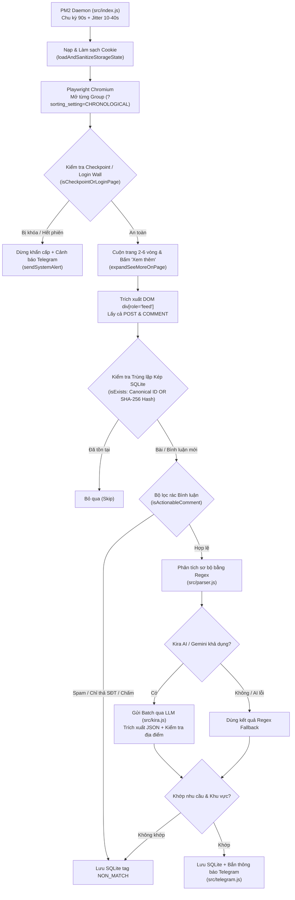

# BÁO CÁO NGHIÊN CỨU & TỔNG HỢP NGUỒN THAM KHẢO
## Thu thập dữ liệu phòng trọ từ Facebook Groups tại Việt Nam & Phân tích bằng AI (AI Room Finder Đà Nẵng)

> [!IMPORTANT]
> **Phạm vi và Phương pháp Kiểm chứng:**
> Toàn bộ nhận định trong báo cáo này được kiểm chứng trực tiếp bằng cách truy xuất cây thư mục, mã nguồn thực tế (`src/`, `scraper.py`, `crawler.js`, `package.json`, `requirements.txt`), lịch sử commit qua GitHub REST API và toàn văn bài viết kỹ thuật qua Viblo API vào thời điểm nghiên cứu.
> Mọi tính năng đều được gắn nhãn phân loại minh bạch:
> - **`[ĐÃ XÁC MINH TỪ MÃ NGUỒN]`**: Đã đọc và kiểm tra trực tiếp trong file code của repository.
> - **`[MÔ TẢ TRONG TÀI LIỆU]`**: Được tác giả trình bày trong README, tài liệu đặc tả hoặc bài viết kỹ thuật nhưng mã nguồn đóng/không công khai phần đó.
> - **`[CHƯA ĐƯỢC XÁC MINH]`**: Không có bằng chứng trong code hoặc tài liệu.
> - **`[KHÔNG CÒN HOẠT ĐỘNG / LỖI THỜI]`**: Sử dụng giao diện/API Facebook cũ đã bị Meta đóng hoặc chỉ là mã giả (boilerplate).

---

## PHẦN 1: DANH SÁCH TOÀN BỘ NGUỒN THAM KHẢO

### 1.1. Các dự án GitHub bắt buộc nghiên cứu (Mandatory Sources)

1. **`apurvmishra99/facebook-scraper-selenium`**
   - **URL:** https://github.com/apurvmishra99/facebook-scraper-selenium
   - **Tóm tắt kiểm chứng:** Dự án Python + Selenium 3 (Firefox GeckoDriver) viết năm 2019–2020, cào bài đăng từ Facebook Pages và Groups ra file `posts.csv`. Hiện tại **`[KHÔNG CÒN HOẠT ĐỘNG / LỖI THỜI]`** do sử dụng CSS class của giao diện Facebook Classic cũ (`userContentWrapper`, `abbr[data-utime]`).

2. **`lesander/fbgs` (Facebook Group Scraper)**
   - **URL:** https://github.com/lesander/fbgs
   - **PyPI:** https://pypi.org/project/fbgs/
   - **Tóm tắt kiểm chứng:** Thư viện Python + Selenium + `gevent` viết năm 2021, đăng nhập và cào nhóm qua giao diện di động cũ `m.facebook.com` dựa vào selector `article.async_like` và `div#MBackNavBar`. Hiện tại **`[KHÔNG CÒN HOẠT ĐỘNG / LỖI THỜI]`** vì Meta đã ngừng giao diện mobile HTML cũ và chuyển sang kiến trúc React/Comet.

3. **`spbotdel/facebook-group-posts-all-photos-scraper`**
   - **URL:** https://github.com/spbotdel/facebook-group-posts-all-photos-scraper
   - **Apify Store:** https://apify.com/spbotdel/facebook-group-posts-all-photos-scraper
   - **Tóm tắt kiểm chứng:** **`[ĐÃ XÁC MINH TỪ MÃ NGUỒN]`** Dự án JavaScript (Node.js ES Modules, Apify Actor v0.3.16, cập nhật mới nhất tháng 11/2026). Không dùng trình duyệt ảo nặng nề mà dùng `got-scraping` + `tough-cookie` gọi trực tiếp GraphQL nội bộ của Facebook (`GroupsCometFeedRegularStoriesPaginationQuery`, `doc_id: 6617440634998224`), đặc biệt giải quyết bài toán **khôi phục toàn bộ ảnh bị ẩn sau lớp phủ `+N` (`pcb.` media set)** của bài đăng nhóm công khai, có mẫu workflow `n8n` giám sát định kỳ.

4. **`data-scrape` (GitHub Organization / User)**
   - **URL:** https://github.com/data-scrape
   - **Các repo con liên quan:**
     - https://github.com/data-scrape/facebook-groups-scraper
     - https://github.com/data-scrape/facebook-group-scraper
     - https://github.com/data-scrape/facebook-marketplace-scraper
     - https://github.com/data-scrape/apartments-scraper
     - https://github.com/data-scrape/ai-agent-web-scraper
   - **Tóm tắt kiểm chứng:** **`[KHÔNG CÒN HOẠT ĐỘNG / LỖI THỜI]`** Qua kiểm tra 241 repositories của tài khoản `data-scrape` và đọc trực tiếp file `scraper.py`, đây là hệ thống repo tạo tự động nhằm mục đích SEO quảng bá cho dịch vụ thương mại `CoreClaw` (`coreclaw.com`). Code trong `facebook-groups-scraper/scraper.py` chỉ gọi `requests.get("https://www.facebook.com/search?q=...")` và tìm các selector giả định (`.result, .item, .description`) hoàn toàn không tồn tại trên Facebook thực tế.

5. **`DevSkits916/AutoMoochFB`**
   - **URL:** https://github.com/DevSkits916/AutoMoochFB
   - **Tóm tắt kiểm chứng:** **`[ĐÃ XÁC MINH TỪ MÃ NGUỒN]`** Ứng dụng Desktop GUI (Python + `tkinter` + `playwright>=1.51`, cập nhật tháng 10/2026) gồm 2 công cụ: `FacebookGroupScanner` (quét kết quả tìm kiếm nhóm theo từ khóa để xuất danh sách Tên nhóm + URL ra CSV, có lọc trùng URL) và `AutoMooch` (tự động xin vào nhóm và đăng bài). Có cơ chế khóa profile trình duyệt liên tiến trình (`msvcrt.locking` / `fcntl.flock` trong `browser_profile.py`) và nhận diện Checkpoint/Captcha (`facebook.py`).

6. **`code-tieumomo/ticket-monitor` (`fb-ticket-monitor` / `fb-badminton-monitor`)**
   - **URL:** https://github.com/code-tieumomo/ticket-monitor
   - **Tóm tắt kiểm chứng:** **`[ĐÃ XÁC MINH TỪ MÃ NGUỒN]`** Dự án mã nguồn mở của lập trình viên Việt Nam (Node.js + Playwright + SQLite + Kira AI / Google Gemini + Telegram Bot + PM2, cập nhật tháng 10/2026). Đây là nguồn tham khảo có kiến trúc gần nhất với bài toán giám sát Facebook Group 24/7 tại Việt Nam: quét nhiều group theo `sorting_setting=CHRONOLOGICAL`, lấy cả bài đăng lẫn bình luận, chống trùng lặp kép (ID + SHA-256 Content Hash), phân tích ngữ nghĩa tiếng Việt viết tắt/teencode bằng Hybrid Engine (Regex + LLM batch), tự động dừng khi gặp Checkpoint và chạy nền 24/7 qua PM2.

---

### 1.2. Case Study thực tế & Bài viết kỹ thuật tại Việt Nam

7. **Homigo – Nền tảng tìm kiếm phòng trọ thông minh với AI**
   - **Website sản phẩm:** https://homigo.life/
   - **Ứng dụng di động:** Google Play (`app.ai.homigo`) & App Store (`id6759665087`)
   - **Tóm tắt kiểm chứng:** **`[MÔ TẢ TRONG TÀI LIỆU]`** Nền tảng tổng hợp tin phòng trọ thực tế tại Việt Nam (Hà Nội, TP.HCM, Đà Nẵng), thu thập hơn 100.000 tin/tuần từ 100–200 Facebook Groups mỗi thành phố kết hợp Chợ Tốt và Batdongsan.

8. **Bài viết kỹ thuật về Homigo trên Viblo**
   - **URL:** https://viblo.asia/p/crawl-100000-tin-phong-tro-moi-tuan-va-phan-tich-bang-gemini-ai-K9Vy8Yd5LQR
   - **Tác giả:** Cáo (`realfox99`) — Xuất bản: `01/04/2026`
   - **Tóm tắt kiểm chứng:** **`[MÔ TẢ TRONG TÀI LIỆU]`** Chia sẻ chi tiết stack công nghệ (Bun, Elysia, MongoDB, Puppeteer + Stealth, Gemini API, React + Vite), quy trình chuẩn hóa tin đăng tiếng Việt viết tắt tại Đà Nẵng (ví dụ thực tế trong bài: *"ptr 2tr5 hc wifi ml"* $\rightarrow$ Hải Châu, Đà Nẵng), cơ chế xoay vòng nhiều API Key (Multi-key rotation) và bài học chuyển dịch từ DOM parsing sang GraphQL interception.

---

### 1.3. Các dự án GitHub mở rộng đã kiểm chứng (Ưu tiên Việt Nam & Kiến trúc tương đương)

9. **`Bwada3/uit-group-crawler` (Việt Nam – UIT)**
   - **URL:** https://github.com/Bwada3/uit-group-crawler
   - **Tóm tắt kiểm chứng:** **`[ĐÃ XÁC MINH TỪ MÃ NGUỒN]`** Dự án Python (cập nhật tháng 10/2026) từ Việt Nam, sử dụng Playwright kết hợp **đọc trực tiếp phản hồi GraphQL/Relay của Facebook** (`web/local_response_reader.py`) với cơ chế tự động fallback về DOM khi lỗi, lưu trữ bền vững vào SQLite (`web/local_store.py`), quản lý nhịp độ/cooldown khi gặp rate-limit tiếng Việt/Anh (`quá nhanh`, `quá nhiều yêu cầu` trong `web/local_throttle.py`), và tích hợp **`RapidOCR` chạy trên CPU** (`web/local_media.py`) để đọc chữ bên trong ảnh đính kèm bài đăng.

10. **`thanh2004nguyen/facebook-group-scraper` (Việt Nam)**
    - **URL:** https://github.com/thanh2004nguyen/facebook-group-scraper
    - **Tóm tắt kiểm chứng:** **`[ĐÃ XÁC MINH TỪ MÃ NGUỒN]`** Dự án Python + Playwright của tác giả Việt Nam (tháng 06/2025). Tách biệt bước đăng nhập lưu phiên (`login_and_save_state.py` $\rightarrow$ `facebook_state.json`) và bước cào (`main.py`), tự động bấm nút `"Xem thêm"` và trích xuất nội dung qua thuộc tính ổn định `div[data-ad-rendering-role='story_message']`.

11. **`huuxuan22/TroHub` (Việt Nam)**
    - **URL:** https://github.com/huuxuan22/TroHub
    - **Tóm tắt kiểm chứng:** **`[ĐÃ XÁC MINH TỪ MÃ NGUỒN]`** Dự án nền tảng tìm phòng trọ tại Việt Nam (FastAPI + MySQL + React, cập nhật tháng 05/2026). Có kiến trúc tách riêng microservice `crawl/` chạy định kỳ theo danh sách địa chỉ người dùng (hỗ trợ Đà Nẵng, Hà Nội, TP.HCM trong `crawl/user_addresses.py`), sau khi cào gọi webhook nội bộ `/trohub/internal/crawl/trigger-normalize` (có bảo mật bằng `X-Crawl-Secret`) để chuẩn hóa dữ liệu nền và tính khoảng cách địa lý (`geocoding.py`). Tuy nhiên crawler hiện tại mới cào `phongtro123.com` chứ chưa cào Facebook Group.

12. **`viseshrp/fbn` (Facebook Group Notification Monitor)**
    - **URL:** https://github.com/viseshrp/fbn
    - **Tóm tắt kiểm chứng:** **`[ĐÃ XÁC MINH TỪ MÃ NGUỒN]`** Dự án Python + Playwright + SQLite + Docker + Apprise (cập nhật tháng 11/2026, 78 files có bộ test rất chặt chẽ). Thiết kế chuyên biệt để chạy daemon 24/7 giám sát bài mới trong các Facebook Group đã tham gia: có máy trạng thái phân loại trang an toàn (`PageState` / `PageSignals` trong `fbn/browser.py`), khóa file chống chạy trùng (`FileLock`), bảng `outbox` chống mất thông báo trong SQLite (`fbn/state.py`), và tự động chụp ảnh màn hình khi lỗi DOM (`fbn/failure_screenshots.py`).

13. **`eladb/fb-group-archiver`**
    - **URL:** https://github.com/eladb/fb-group-archiver
    - **Tóm tắt kiểm chứng:** **`[ĐÃ XÁC MINH TỪ MÃ NGUỒN]`** Dự án Python + Playwright + SQLite (cập nhật tháng 10/2026). Thay vì parse DOM, công cụ này **chặn bắt (intercept) toàn bộ luồng `POST /api/graphql/`** từ trình duyệt Chrome đã đăng nhập, lưu nguyên bản gói tin vào `raw.ndjson.gz` trước khi bóc tách sang SQLite (`archive.db`), và tải ảnh chống trùng lặp theo địa chỉ nội dung `media/ab/cd/<sha256>.jpg`.

14. **`ShakedSas77/Find-Apartment`**
    - **URL:** https://github.com/ShakedSas77/Find-Apartment
    - **Tóm tắt kiểm chứng:** **`[ĐÃ XÁC MINH TỪ MÃ NGUỒN]`** Bot Python (cập nhật tháng 11/2026) có luồng nghiệp vụ giống hệt bài toán AI Room Finder: quét các Facebook Group cho thuê căn hộ $\rightarrow$ dùng **Google Gemini API (có fallback sang Ollama cục bộ)** trong `core/llm.py` để bóc tách cấu trúc $\rightarrow$ nhận diện môi giới (`is_broker`) và loại bỏ bài tìm phòng (seeker posts) $\rightarrow$ tính khoảng cách đi bộ qua Google Maps / OpenStreetMap (`integrations/maps.py`, `distance_fallback.py`) $\rightarrow$ chấm điểm độ phù hợp (`core/scoring.py`) và bắn thông báo qua Telegram (`integrations/telegram_notifier.py`).

15. **`MasuRii/FBScrapeIdeas`**
    - **URL:** https://github.com/MasuRii/FBScrapeIdeas
    - **Tóm tắt kiểm chứng:** **`[ĐÃ XÁC MINH TỪ MÃ NGUỒN]`** Công cụ CLI Python (73 stars, cập nhật tháng 12/2025) cào bài viết + bình luận từ Facebook Group, lưu SQLite (`database/db_setup.py`) và phân tích hàng loạt bằng `Google Gemini` hoặc `OpenAI-compatible API` (hỗ trợ cả **Ollama** cục bộ qua `ai/openai_provider.py` và `ai/provider_factory.py`) với JSON Schema định sẵn (`ai/gemini_schema.json`).

16. **`kevinzg/facebook-scraper`**
    - **URL:** https://github.com/kevinzg/facebook-scraper
    - **Tóm tắt kiểm chứng:** Thư viện Python nổi tiếng nhất trước đây (3.324 stars, commit cuối tháng 06/2024). Dựa trên việc parse HTML của `m.facebook.com` / `mbasic.facebook.com` qua `requests_html`. Hiện tại **`[KHÔNG CÒN HOẠT ĐỘNG / LỖI THỜI]`** với phần lớn Facebook Groups do Meta đã chặn truy cập không trình duyệt và gỡ bỏ `mbasic`.

---

### 1.4. Tài liệu chính thức & Công cụ / Thư viện nền tảng

- **Meta Graph API Changelog v19.0 (Deprecation of Groups API):** Tài liệu chính thức của Meta xác nhận việc đóng hoàn toàn quyền truy cập Groups API đối với ứng dụng bên thứ ba sau 90 ngày kể từ v19.0 (tháng 04/2024).
- **Playwright Documentation (`BrowserContext.storageState` & `page.on('response')`):** Tài liệu chính thức về duy trì phiên đăng nhập cookie/localStorage và chặn bắt gói tin mạng (Network Interception).
- **Thư viện đã kiểm chứng trong các dự án:**
  - Tự động hóa trình duyệt: `playwright` (Node.js / Python), `puppeteer` + `puppeteer-extra-plugin-stealth`.
  - HTTP Scraping nâng cao (giả lập TLS fingerprint): `got-scraping` + `tough-cookie` (dùng trong `spbotdel`).
  - Cơ sở dữ liệu nhúng & Chống trùng: `better-sqlite3`, `node:sqlite`, `sqlite3` (Python), `MongoDB`.
  - OCR đọc chữ trên ảnh phòng trọ: `rapidocr` + `onnxruntime` + `Pillow` (dùng trong `Bwada3/uit-group-crawler`).
  - Tích hợp AI: `@google/genai` (Gemini SDK), `openai` SDK (kết nối Ollama / Kira AI / OpenRouter).
  - Quản lý tiến trình 24/7 & Cảnh báo: `pm2`, `Docker Compose`, `Telegram Bot API`, `Apprise`.

---

## PHẦN 2: BẢNG SO SÁNH & ĐÁNH GIÁ CHI TIẾT CÁC DỰ ÁN

### 2.1. Bảng ma trận tổng hợp các dự án

| # | Dự án / Nguồn | Nguồn gốc | Công nghệ chính | Phương pháp thu thập FB | Theo dõi bài mới 24/7 | Thu thập Ảnh | Đa Group | Chống trùng (Dedupe) | Tích hợp AI | Tình trạng hoạt động (2026) | Mức độ phù hợp cho Phòng Ơi Đà Nẵng |
| :--- | :--- | :--- | :--- | :--- | :--- | :--- | :--- | :--- | :--- | :--- | :--- |
| **1** | [`facebook-scraper-selenium`](https://github.com/apurvmishra99/facebook-scraper-selenium) | Quốc tế (Ấn Độ) | Python, Selenium 3 (Firefox) | DOM Classic (`userContentWrapper`) | Không (chạy 1 lần) | Không | Có (`--groups`) | Không | Không | **Ngừng hoạt động** (Commit cuối: 06/2020) | **Không phù hợp** (Code và selector đã hỏng hoàn toàn) |
| **2** | [`lesander/fbgs`](https://github.com/lesander/fbgs) | Quốc tế (Hà Lan) | Python, Selenium, `gevent` | DOM `m.facebook.com` (`article.async_like`) | Không (chạy 1 lần) | Rất hạn chế | Không (1 URL/lần) | Không | Không | **Ngừng hoạt động** (Commit cuối: 01/2021) | **Không phù hợp** (Giao diện `m.facebook` cũ đã bị xóa) |
| **3** | [`spbotdel/facebook-group-posts-all-photos-scraper`](https://github.com/spbotdel/facebook-group-posts-all-photos-scraper) | Quốc tế | Node.js, Apify, `got-scraping`, `tough-cookie` | GraphQL `GroupsCometFeed...` + mở rộng tập ảnh `pcb.` | Có (qua n8n / Cursor backfill) | **Rất mạnh** (Lấy đủ ảnh ẩn `+N`) | Có (Tối đa 10 nhóm/lần) | Có (`source_post_id` + `mediaKey`) | Chuẩn hóa JSON cho AI Agent / MCP | **Đang hoạt động tốt** (Cập nhật: 11/2026) | **Cao** (Tham khảo xuất sắc cách lấy toàn bộ ảnh `+N` và parse GraphQL) |
| **4** | [`data-scrape/*`](https://github.com/data-scrape) | Quốc tế (CoreClaw) | Python, `requests`, `BeautifulSoup` | Gửi HTTP GET `/search?q=` giả định | Không | Không | Không | Hash chuỗi sơ sài | Không (chỉ mô tả README) | **Không hoạt động** (Repo SEO mẫu) | **Không phù hợp** (Mã nguồn giả, không chạy được với FB) |
| **5** | [`DevSkits916/AutoMoochFB`](https://github.com/DevSkits916/AutoMoochFB) | Quốc tế | Python, `tkinter`, Playwright | Quét tìm kiếm Group + Tự động đăng bài | Không (Công cụ quét tên nhóm & auto-post) | Không | Có (Quét & lưu CSV) | Lọc trùng URL nhóm (`casefold`) | Không | **Đang hoạt động** (Cập nhật: 10/2026) | **Trung bình - Thấp** (Chỉ hữu ích phần tự động tìm URL các nhóm trọ Đà Nẵng và khóa profile) |
| **6** | [`code-tieumomo/ticket-monitor`](https://github.com/code-tieumomo/ticket-monitor) | **Việt Nam** | Node.js, Playwright, SQLite, PM2, Telegram | DOM Comet (`div[role="feed"]`) + `CHRONOLOGICAL` + Cookie | **Có (24/7)** (PM2 + Jitter Polling 90s) | **Không** (Chỉ lấy text bài + comment) | **Có** (Quét tuần tự + delay 4–7s) | **Rất mạnh** (ID + SHA-256 Content Hash) | **Có** (Hybrid Regex + Kira AI / Gemini Batch) | **Đang hoạt động tốt** (Cập nhật: 10/2026) | **Rất cao** (Kiến trúc mẫu cho daemon 24/7, quản lý cookie, chống checkpoint & dedupe) |
| **7, 8** | **Homigo** ([`homigo.life`](https://homigo.life/) & [Viblo](https://viblo.asia/p/crawl-100000-tin-phong-tro-moi-tuan-va-phan-tich-bang-gemini-ai-K9Vy8Yd5LQR)) | **Việt Nam** | Bun, Elysia, MongoDB, Puppeteer Stealth, Gemini | Puppeteer DOM / GraphQL Intercept + Đa nguồn | **Có (24/7)** (100.000+ tin/tuần) | Có (hiển thị trên web/app) | **Có** (100–200 nhóm/TP) | Có (Tỷ lệ lọc thành công 82%) | **Có** (Gemini JSON mode + Multi-key rotation) | **Đang hoạt động thương mại** (04/2026) | **Rất cao** (Case study thực chiến đúng bài toán phòng trọ Đà Nẵng) |
| **9** | [`Bwada3/uit-group-crawler`](https://github.com/Bwada3/uit-group-crawler) | **Việt Nam (UIT)** | Python, Playwright, SQLite, `RapidOCR` | **Hybrid: GraphQL Response Reader + DOM Fallback** | Có (Lưu trạng thái phân trang & hàng đợi) | **Có + OCR** (Tải ảnh SHA-256 + đọc chữ trên ảnh) | Có | Có (SQLite ID/URL + SHA-256 ảnh) | Có (`RapidOCR` trích xuất chữ từ ảnh) | **Đang hoạt động tốt** (Cập nhật: 10/2026) | **Rất cao** (Cùng stack Python với Phòng Ơi, giải quyết được cả GraphQL lẫn OCR ảnh trọ) |
| **10** | [`thanh2004nguyen/facebook-group-scraper`](https://github.com/thanh2004nguyen/facebook-group-scraper) | **Việt Nam** | Python, Playwright | DOM (`data-ad-rendering-role='story_message'`) | Không (Chạy theo số bài `DESIRED_POSTS`) | Không | Không (1 URL trong `main.py`) | Trong bộ nhớ (`set()`) | Không | **Hoạt động cơ bản** (Cập nhật: 06/2025) | **Trung bình** (Tham khảo selector `story_message` gọn nhẹ và lưu `storage_state`) |
| **11** | [`viseshrp/fbn`](https://github.com/viseshrp/fbn) | Quốc tế | Python, Playwright, SQLite, Docker, Apprise | Mobile DOM + PageState Classification | **Có (24/7)** (Adaptive backoff + Outbox) | Có metadata đính kèm | **Có** (Quản lý lịch quét từng nhóm) | **Rất mạnh** (SQLite `posts` + `outbox` boundary) | Không | **Đang hoạt động tốt** (Cập nhật: 11/2026) | **Cao** (Tham khảo thiết kế máy trạng thái an toàn và hàng đợi thông báo) |
| **12** | [`eladb/fb-group-archiver`](https://github.com/eladb/fb-group-archiver) | Quốc tế | Python, Playwright, SQLite | **100% GraphQL Interception (`POST /api/graphql/`)** | Có (Resumable crawl state) | **Có** (CDN URLs + tải file `<sha256>.jpg`) | Có | Có (SQLite + SHA-256 media) | Không | **Đang hoạt động tốt** (Cập nhật: 10/2026) | **Cao** (Tham khảo kỹ thuật bắt gói tin GraphQL nguyên bản để không bao giờ gãy selector) |
| **13** | [`ShakedSas77/Find-Apartment`](https://github.com/ShakedSas77/Find-Apartment) | Quốc tế | Python, Playwright, Gemini + **Ollama**, SQLite | Playwright Group Scraper | **Có** (Scheduled bot + Telegram) | Không lưu ảnh | **Có** (`groups_sync.py`) | Có (`core/dedupe.py` + `storage.py`) | **Có** (Gemini + **fallback Ollama** + tính khoảng cách) | **Đang hoạt động tốt** (Cập nhật: 11/2026) | **Rất cao** (Cùng mô hình Gemini + Ollama fallback + tính khoảng cách địa lý) |
| **14** | [`MasuRii/FBScrapeIdeas`](https://github.com/MasuRii/FBScrapeIdeas) | Quốc tế | Python, Selenium/Playwright, SQLite, Gemini/Ollama | Browser Auth + Self-healing selectors | Không (CLI chạy theo lệnh) | Không | Có | Có (SQLite `database/crud.py`) | **Có** (Gemini + OpenAI/Ollama provider factory) | **Đang hoạt động** (Cập nhật: 12/2025) | **Trung bình - Cao** (Tham khảo kiến trúc `provider_factory.py` cho Gemini/Ollama) |

---

### 2.2. Đánh giá chi tiết từng nguồn theo 13 Tiêu chí Bắt buộc

#### Nguồn 1: `facebook-scraper-selenium`
1. **Tên & Đường dẫn:** `apurvmishra99/facebook-scraper-selenium` — https://github.com/apurvmishra99/facebook-scraper-selenium
2. **Quốc gia / Nguồn gốc:** Quốc tế (Ấn Độ).
3. **Công nghệ & Thư viện:** Python 3, `selenium >= 3.141.0` (Firefox `GeckoDriver`), `csv` (`[ĐÃ XÁC MINH TỪ MÃ NGUỒN]`: `fb-scraper/scraper.py`).
4. **Mục đích chính:** Thu thập bài đăng từ trang hoặc nhóm Facebook xuất ra file `posts.csv` phục vụ mục đích học tập mà không cần Graph API.
5. **Chức năng đã triển khai (`[ĐÃ XÁC MINH TỪ MÃ NGUỒN]`):**
   - Mở trình duyệt Firefox theo profile cấu hình sẵn trong `settings.py`.
   - Cuộn trang (`window.scrollTo(0, document.body.scrollHeight)`) theo số lần `depth` với độ trễ cố định `delay=2` giây.
   - Bấm mở rộng liên kết `"See more"` (`find_elements_by_link_text("See more")`).
   - Trích xuất 3 trường: Tên người đăng (`//a[@data-hovercard-referer]`), thời gian (`abbr[data-utime]`), và văn bản (`class="userContent"`), ghi vào `posts.csv`.
6. **Phương pháp thu thập:** Tự động hóa trình duyệt trên giao diện Desktop cổ điển (`www.facebook.com/groups/<id>/`).
7. **Khả năng theo dõi bài mới:** **Không có** (`[ĐÃ XÁC MINH TỪ MÃ NGUỒN]`). Chạy một lượt rồi đóng trình duyệt (`self.browser.close()`).
8. **Khả năng thu thập nhiều Group:** **Có** (`[ĐÃ XÁC MINH TỪ MÃ NGUỒN]`). Nhận danh sách `--groups` qua CLI và lặp tuần tự `for iden in self.ids: self.collect_groups(iden)`.
9. **Phương pháp xử lý trùng lặp:** **Không có** (`[ĐÃ XÁC MINH TỪ MÃ NGUỒN]`). Mỗi lần chạy đều ghi đè hoặc nối tiếp vào `posts.csv` mà không kiểm tra ID.
10. **Khả năng tích hợp AI:** **Không có**.
11. **Khả năng áp dụng vào tìm phòng trọ Đà Nẵng:** **Không thể áp dụng** do không lấy được ảnh, không lấy được link bài gốc, và bộ selector đã hoàn toàn lỗi thời.
12. **Tình trạng hoạt động & Cập nhật gần nhất:** **`[KHÔNG CÒN HOẠT ĐỘNG / LỖI THỜI]`** — Commit cuối cùng ngày `28/06/2020`. Các hàm `find_elements_by_class_name` đã bị xóa từ Selenium 4, và các class `userContentWrapper`, `data-utime` đã bị Facebook loại bỏ từ khi chuyển sang giao diện Comet (React).
13. **Giấy phép & Giới hạn:** `GNU General Public License v3.0 (GPL-3.0)`. Tác giả ghi chú rõ trong docstring chỉ dùng cho mục đích giáo dục.

---

#### Nguồn 2: `fbgs` (lesander/fbgs)
1. **Tên & Đường dẫn:** `lesander/fbgs` — https://github.com/lesander/fbgs
2. **Quốc gia / Nguồn gốc:** Quốc tế (Hà Lan).
3. **Công nghệ & Thư viện:** Python 3.6+, `selenium`, `gevent` (`[ĐÃ XÁC MINH TỪ MÃ NGUỒN]`: `requirements.txt`, `scraper/scraper.py`).
4. **Mục đích chính:** Thư viện CLI và Python package cào bài đăng nhóm Facebook qua giao diện di động nhằm tránh các class CSS bị làm rối (obfuscated) trên bản desktop.
5. **Chức năng đã triển khai (`[ĐÃ XÁC MINH TỪ MÃ NGUỒN]`):**
   - Tự động đăng nhập tài khoản bằng `username`/`password` trên `m.facebook.com`, tự động bấm qua màn hình GDPR và lưu thiết bị (`/login/save-device`).
   - Cuộn và đợi bài đăng mới xuất hiện dựa trên số lượng phần tử `article.async_like`.
   - Xuất kết quả ra file JSON (`save_json`).
6. **Phương pháp thu thập:** Selenium điều khiển trình duyệt truy cập `m.facebook.com/groups/...` và parse các thẻ HTML di động (`article.async_like`, `div#MBackNavBar`).
7. **Khả năng theo dõi bài mới:** **Không có** (chỉ cuộn xuống lấy bài cũ cho đến khi đạt `max` rồi dừng).
8. **Khả năng thu thập nhiều Group:** **Không có** trong CLI (nhận 1 tham số `--url` duy nhất).
9. **Phương pháp xử lý trùng lặp:** Chỉ cắt danh sách phần tử trong 1 phiên chạy (`all_post_elements[post_offset:]`), không có cơ sở dữ liệu lưu trữ giữa các lần chạy.
10. **Khả năng tích hợp AI:** **Không có**.
11. **Khả năng áp dụng vào tìm phòng trọ Đà Nẵng:** **Không thể áp dụng trực tiếp** vì giao diện `m.facebook.com` với thẻ `article.async_like` không còn tồn tại.
12. **Tình trạng hoạt động & Cập nhật gần nhất:** **`[KHÔNG CÒN HOẠT ĐỘNG / LỖI THỜI]`** — Commit cuối cùng ngày `31/01/2021`.
13. **Giấy phép & Giới hạn:** `MIT License`.

---

#### Nguồn 3: `facebook-group-posts-all-photos-scraper` (spbotdel)
1. **Tên & Đường dẫn:** `spbotdel/facebook-group-posts-all-photos-scraper` — https://github.com/spbotdel/facebook-group-posts-all-photos-scraper
2. **Quốc gia / Nguồn gốc:** Quốc tế.
3. **Công nghệ & Thư viện:** Node.js (ES Modules), `apify ^3.4.5`, `got-scraping ^4.1.2`, `tough-cookie ^5.1.2`, `html-entities ^2.6.0` (`[ĐÃ XÁC MINH TỪ MÃ NGUỒN]`: `package.json`).
4. **Mục đích chính:** Apify Actor chuyên thu thập bài đăng từ các Facebook Group công khai kèm **toàn bộ URL hình ảnh gốc** (kể cả các ảnh bị ẩn sau biểu tượng `+N` khi bài đăng có trên 5 ảnh), xuất ra JSON chuẩn hóa cho AI Agent / MCP / n8n.
5. **Chức năng đã triển khai (`[ĐÃ XÁC MINH TỪ MÃ NGUỒN]` — `src/main.js`, `src/htmlMedia.js`, `src/mediaQuality.js`):**
   - Gửi truy vấn HTTP giả lập trình duyệt (`got-scraping`) tới endpoint GraphQL của Facebook (`GroupsCometFeedRegularStoriesPaginationQuery`, fallback `doc_id: 6617440634998224`).
   - Hỗ trợ phân trang bằng con trỏ (`end_cursor`, `has_next_page`) và lọc theo khoảng thời gian (`src/dateRange.js`).
   - **Khôi phục toàn bộ ảnh (`expandAllPhotos`):** Khi bài viết có từ 5 ảnh trở lên và xuất hiện lớp phủ `+N`, bộ cào truy xuất tiếp vào media set (`pcb.`) để lấy đủ toàn bộ danh sách ảnh chất lượng cao và chấm điểm mức độ hoàn thiện media (`media_completeness`, `media_review_severity`).
   - Nhận diện tường đăng nhập tạm thời (`coverageStatus: "blocked_login_wall"`, `loginWallDetected: true`) để tách nhóm bị chặn khỏi các nhóm khỏe mạnh.
6. **Phương pháp thu thập:** HTTP/GraphQL scraping không cần chạy trình duyệt headless (Browserless HTTP + Relay/GraphQL parsing), dùng proxy session (`src/proxySession.js`).
7. **Khả năng theo dõi bài mới:** **Có** (`[ĐÃ XÁC MINH TỪ MÃ NGUỒN]`). Cung cấp cấu hình `CHRONOLOGICAL` và file workflow mẫu `docs/n8n/group-to-google-sheets-slack.json` chạy định kỳ để đẩy bài mới vào Google Sheets và báo về Slack.
8. **Khả năng thu thập nhiều Group:** **Có** (`MAX_GROUPS_PER_RUN = 10` trong `src/main.js`).
9. **Phương pháp xử lý trùng lặp:** Khử trùng lặp bài viết theo `source_post_id` và khử trùng lặp ảnh bằng hàm `mediaKey()` chuẩn hóa URL CDN trong `src/htmlMedia.js`.
10. **Khả năng tích hợp AI:** Không gọi LLM trực tiếp bên trong Actor, nhưng thiết kế đầu ra chuyên biệt cho AI Agent (`llms.txt`, `docs/AGENT_GUIDE.md`, `docs/LLM_AGENT_PLAYBOOK.md`, `docs/MCP_USAGE.md`).
11. **Khả năng áp dụng vào tìm phòng trọ Đà Nẵng:** **Rất cao ở module thu thập ảnh và GraphQL**. Các chủ trọ/môi giới Đà Nẵng thường đăng 6–12 ảnh (phòng ngủ, bếp, WC, ban công, mặt tiền); giải thuật mở rộng `pcb.` media set và chuẩn hóa URL ảnh trong `src/htmlMedia.js` giải quyết triệt để lỗi thiếu ảnh.
12. **Tình trạng hoạt động & Cập nhật gần nhất:** **`[ĐÃ XÁC MINH TỪ MÃ NGUỒN]` Đang hoạt động tích cực** — Phiên bản `0.3.16`, commit gần nhất: `05/11/2026`.
13. **Giấy phép & Giới hạn:** `MIT License`. **Giới hạn (`docs/LIMITATIONS.md`):** Chỉ hỗ trợ nhóm công khai (Public Groups), không hỗ trợ truyền cookie đăng nhập cho nhóm riêng tư (Private Groups), không cào bình luận mở rộng.

---

#### Nguồn 4: `data-scrape` (GitHub User/Org)
1. **Tên & Đường dẫn:** `data-scrape` — https://github.com/data-scrape (gồm `data-scrape/facebook-groups-scraper`, `data-scrape/facebook-group-scraper`, `data-scrape/apartments-scraper`, v.v.)
2. **Quốc gia / Nguồn gốc:** Quốc tế (tài trợ bởi nền tảng thương mại `CoreClaw`).
3. **Công nghệ & Thư viện:** Python 3, `requests`, `beautifulsoup4`, `lxml` (`[ĐÃ XÁC MINH TỪ MÃ NGUỒN]`: `scraper.py`).
4. **Mục đích chính:** Bộ 241 kho lưu trữ mẫu tạo tự động bằng template nhằm mục đích SEO thu hút người dùng sang nền tảng API trả phí `coreclaw.com`.
5. **Chức năng đã triển khai (`[ĐÃ XÁC MINH TỪ MÃ NGUỒN]`):**
   - Khi kiểm tra trực tiếp `facebook-groups-scraper/scraper.py` và `apartments-scraper/scraper.py`, cả hai file có cấu trúc code giống hệt nhau đến 98%: chỉ gửi `requests.Session().get("https://www.facebook.com/search?q=...")` không có cookie, không có thực thi JavaScript, và dùng BeautifulSoup quét các thẻ giả định `soup.select('[data-testid], .result, .item, article')`.
6. **Phương pháp thu thập:** HTTP GET tĩnh đơn thuần (hoàn toàn bị Facebook chặn hoặc trả về trang vỏ rỗng).
7. **Khả năng theo dõi bài mới:** **Không có**.
8. **Khả năng thu thập nhiều Group:** **Không có**.
9. **Phương pháp xử lý trùng lặp:** Chỉ băm tạm `str(hash(item.url or item.title))[:12]`.
10. **Khả năng tích hợp AI:** Không có trong code (chỉ viết giới thiệu khái niệm trong `README.md` của `ai-agent-web-scraper`).
11. **Khả năng áp dụng vào tìm phòng trọ Đà Nẵng:** **Bằng 0**.
12. **Tình trạng hoạt động & Cập nhật gần nhất:** **`[KHÔNG CÒN HOẠT ĐỘNG / LỖI THỜI]`** (Commit đẩy hàng loạt tháng 08/2026 nhưng là code boilerplate không hoạt động thực tế).
13. **Giấy phép & Giới hạn:** `MIT License`.

---

#### Nguồn 5: `AutoMoochFB` (DevSkits916/AutoMoochFB)
1. **Tên & Đường dẫn:** `DevSkits916/AutoMoochFB` — https://github.com/DevSkits916/AutoMoochFB
2. **Quốc gia / Nguồn gốc:** Quốc tế.
3. **Công nghệ & Thư viện:** Python, `tkinter` (GUI), `playwright>=1.51,<2` (`[ĐÃ XÁC MINH TỪ MÃ NGUỒN]`: `requirements.txt`, `facebook_group_scanner.py`, `facebook.py`).
4. **Mục đích chính:** Công cụ Desktop tự động tìm kiếm danh sách các Facebook Group theo từ khóa (`facebook_group_scanner.py`) xuất ra CSV, sau đó tự động tham gia nhóm và đăng bài hàng loạt (`facebook.py`, `app.py`).
5. **Chức năng đã triển khai (`[ĐÃ XÁC MINH TỪ MÃ NGUỒN]`):**
   - Mở trình duyệt Edge/Chrome thật qua Playwright với thư mục profile lưu trữ lâu dài (`browser_profile.py`).
   - Cơ chế `profile_lease` dùng khóa cấp hệ điều hành (`msvcrt.locking` trên Windows, `fcntl.flock` trên Linux/macOS) để ngăn nhiều tiến trình mở cùng một profile trình duyệt gây hỏng cookie.
   - Quét trang tìm kiếm nhóm của Facebook theo danh sách từ khóa, lọc URL chuẩn `/groups/<slug>` và loại bỏ các đường dẫn hệ thống (`feed`, `discover`, `joins`, `search`), khử trùng lặp URL nhóm và xuất ra CSV.
   - Phát hiện trạng thái `CHECKPOINT` và `CAPTCHA` khi thao tác trên Facebook.
6. **Phương pháp thu thập:** Playwright điều khiển trình duyệt có lưu persistent profile.
7. **Khả năng theo dõi bài mới:** **Không có** (chỉ quét danh sách tên/URL nhóm và đi đăng bài, không đọc bài đăng bên trong nhóm).
8. **Khả năng thu thập nhiều Group:** Có ở khâu tìm kiếm danh sách Group.
9. **Phương pháp xử lý trùng lặp:** Khử trùng URL nhóm bằng khóa `url.casefold()`.
10. **Khả năng tích hợp AI:** **Không có** (tác giả ghi rõ dùng kịch bản Playwright thuần để không tốn chi phí gọi AI điều khiển trình duyệt).
11. **Khả năng áp dụng vào tìm phòng trọ Đà Nẵng:** **Hữu ích một phần**: Module `facebook_group_scanner.py` và `browser_profile.py` có thể tham khảo để tự động khám phá hàng trăm nhóm *"Phòng trọ Đà Nẵng"*, *"Nhà nguyên căn Sơn Trà"*, *"Ở ghép sinh viên Duy Tân / Bách Khoa"* và cơ chế khóa file `msvcrt.locking` trên Windows.
12. **Tình trạng hoạt động & Cập nhật gần nhất:** **`[ĐÃ XÁC MINH TỪ MÃ NGUỒN]` Đang hoạt động** — Commit gần nhất: `18/10/2026`.
13. **Giấy phép & Giới hạn:** Không khai báo file `LICENSE` (All rights reserved mặc định của GitHub).

---

#### Nguồn 6: `fb-ticket-monitor` (`code-tieumomo/ticket-monitor`)
1. **Tên & Đường dẫn:** `code-tieumomo/ticket-monitor` — https://github.com/code-tieumomo/ticket-monitor
2. **Quốc gia / Nguồn gốc:** **Việt Nam**.
3. **Công nghệ & Thư viện:** Node.js, `playwright ^1.50.0`, `better-sqlite3 ^11.8.1` (kèm fallback sang `node:sqlite`), `openai ^7.45.1` (kết nối Kira AI), `@google/genai ^2.31.0` (Google Gemini), `dotenv`, `pm2` (`[ĐÃ XÁC MINH TỪ MÃ NGUỒN]`: `package.json`, `pm2.config.js`).
4. **Mục đích chính:** Hệ thống bot chạy 24/7 giám sát các bài đăng và bình luận mới nhất trên nhiều Facebook Group tại Việt Nam (ban đầu thiết kế cho săn vé concert trong `k_ho_ch_tri_n_khai_bot_qu_t_v_concert_facebook.md`, sau đó triển khai thực tế cho giám sát kèo giao lưu cầu lông tại Hà Nội trong `src/`), phân tích bằng Regex + AI và đẩy thông báo tức thì về Telegram.
5. **Chức năng đã triển khai (`[ĐÃ XÁC MINH TỪ MÃ NGUỒN]`):** Xem phân tích chuyên sâu tại **Phần 3**.
6. **Phương pháp thu thập:** Playwright Chromium nạp `storageState` (`cookies/fb-auth.json`), mở từng group với tham số `?sorting_setting=CHRONOLOGICAL`, cuộn trang, bấm `"Xem thêm"`, trích xuất bài viết và bình luận từ `div[role="feed"]`.
7. **Khả năng theo dõi bài mới:** **Rất mạnh (24/7)** — Vòng lặp `while (isRunning)` kết hợp chu kỳ quét ngẫu nhiên (`90s + random 10–40s`) và quản lý tự khởi động lại bằng `PM2`.
8. **Khả năng thu thập nhiều Group:** **Có** — Cấu hình qua biến môi trường `FB_GROUP_URLS`, tự động gắn `sorting_setting=CHRONOLOGICAL` và nghỉ ngẫu nhiên `4–7 giây` giữa mỗi nhóm.
9. **Phương pháp xử lý trùng lặp:** **Khử trùng lặp kép (Dual-key Deduplication)** trên SQLite: kiểm tra đồng thời `id` (`fb_post_<id>` / `fb_cmt_<id>`) VÀ `content_hash` (`fp_<sha256>`).
10. **Khả năng tích hợp AI:** **Rất mạnh** — Tích hợp Hybrid Engine (Regex sơ lọc + gửi gom lô `analyzeBatch` qua LLM API chuẩn OpenAI/Gemini để trích xuất JSON có cấu trúc và tóm tắt 1 câu).
11. **Khả năng áp dụng vào tìm phòng trọ Đà Nẵng:** **Cực kỳ cao (90% kiến trúc cốt lõi có thể chuyển giao)**, chỉ cần bổ sung thêm phần trích xuất mảng URL hình ảnh và đổi bộ luật/prompt sang nghiệp vụ phòng trọ Đà Nẵng.
12. **Tình trạng hoạt động & Cập nhật gần nhất:** **`[ĐÃ XÁC MINH TỪ MÃ NGUỒN]` Đang hoạt động tốt** — Commit gần nhất: `29/10/2026`.
13. **Giấy phép & Giới hạn:** Khai báo `"license": "ISC"` trong `package.json`.

---

#### Nguồn 7 & 8: Case Study `Homigo` (`homigo.life` & Bài viết Viblo)
1. **Tên & Đường dẫn:**
   - Sản phẩm: https://homigo.life/
   - Bài viết kỹ thuật: https://viblo.asia/p/crawl-100000-tin-phong-tro-moi-tuan-va-phan-tich-bang-gemini-ai-K9Vy8Yd5LQR
2. **Quốc gia / Nguồn gốc:** **Việt Nam** (Tác giả: `Cáo / realfox99`, hỗ trợ thị trường Đà Nẵng, Hà Nội, TP.HCM).
3. **Công nghệ & Thư viện (`[MÔ TẢ TRONG TÀI LIỆU]`):** Runtime `Bun`, Backend `Elysia`, Database `MongoDB`, Crawler `Puppeteer` + `puppeteer-extra-plugin-stealth`, AI `Google Gemini API`, Frontend `React + Vite` trên Cloudflare Pages.
4. **Mục đích chính:** Nền tảng tổng hợp, chuẩn hóa và tìm kiếm phòng trọ bằng AI tại Việt Nam.
5. **Chức năng đã triển khai (`[MÔ TẢ TRONG TÀI LIỆU]` & kiểm chứng giao diện web):** Xem phân tích chuyên sâu tại **Phần 4**.
6. **Phương pháp thu thập:** Puppeteer Stealth mở group, cuộn feed, parse DOM / chặn bắt GraphQL trên 100–200 Facebook Groups mỗi thành phố, kết hợp adapter riêng cho Chợ Tốt và Batdongsan.
7. **Khả năng theo dõi bài mới:** **Có** — Thu thập liên tục đạt lưu lượng >100.000 tin/tuần.
8. **Khả năng thu thập nhiều Group:** **Rất lớn** (100–200 nhóm/thành phố).
9. **Phương pháp xử lý trùng lặp:** Chuẩn hóa về một Schema phẳng chung, lọc tin trùng và lỗi (tỷ lệ tin hợp lệ sau xử lý đạt 82%).
10. **Khả năng tích hợp AI:** Dùng Google Gemini API (JSON mode) kết hợp xoay vòng nhiều API Key (Multi-key rotation) để bóc tách giá, diện tích, quận, loại phòng, tiện ích, phân biệt chính chủ/môi giới (`isBroker`) và tin cho thuê (`isRental`).
11. **Khả năng áp dụng vào tìm phòng trọ Đà Nẵng:** **100% đúng bài toán mục tiêu** (bài viết trên Viblo lấy chính ví dụ tin đăng phòng trọ đường Lê Duẩn, Quận Hải Châu, Đà Nẵng làm mẫu).
12. **Tình trạng hoạt động & Cập nhật gần nhất:** **Đang hoạt động thương mại** (Bài viết đăng ngày `01/04/2026`, web và app iOS/Android đang chạy thực tế).
13. **Giấy phép & Giới hạn:** Sản phẩm thương mại đóng mã nguồn (Closed-source); kiến trúc được chia sẻ công khai qua bài viết kỹ thuật trên Viblo.

---

#### Các nguồn mở rộng tiêu biểu (Nguồn 9 – 14)

- **Nguồn 9 (`Bwada3/uit-group-crawler` – Việt Nam):**
  - **`[ĐÃ XÁC MINH TỪ MÃ NGUỒN]`** (Python, Playwright, SQLite, `RapidOCR`, GPL-3.0, cập nhật `19/10/2026`).
  - **Điểm đắt giá nhất:** Kết hợp đọc trực tiếp gói tin phản hồi của Facebook (`FACEBOOK_RESPONSE_READER=1` trong `web/local_response_reader.py`) với fallback tự động sang DOM; tải ảnh về máy đặt tên theo hàm băm `sha256(raw)` và chạy **`RapidOCR` trên CPU** (`web/local_media.py`) để đọc chữ in trên ảnh; tự động phát hiện thông báo giới hạn tốc độ bằng cả tiếng Việt lẫn tiếng Anh (`quá nhanh|quá nhiều yêu cầu|rate limit|temporarily blocked` trong `web/local_throttle.py`).
- **Nguồn 10 (`thanh2004nguyen/facebook-group-scraper` – Việt Nam):**
  - **`[ĐÃ XÁC MINH TỪ MÃ NGUỒN]`** (Python, Playwright, MIT License, cập nhật `26/06/2025`).
  - **Điểm đắt giá nhất:** Minh họa cách dùng selector ngữ nghĩa mới của Facebook Comet: `page.locator("div[data-ad-rendering-role='story_message']")` rất gọn nhẹ và ít bị ảnh hưởng khi class CSS thay đổi.
- **Nguồn 11 (`viseshrp/fbn`):**
  - **`[ĐÃ XÁC MINH TỪ MÃ NGUỒN]`** (Python, Playwright, SQLite, Apprise, Docker, MIT License, cập nhật `11/2026`).
  - **Điểm đắt giá nhất:** Thiết kế cơ sở dữ liệu trạng thái cực kỳ bài bản (`groups`, `posts`, `outbox` trong `fbn/state.py`), ghi nhớ `notification_boundary_post_id` và `consecutive_failures` để tính toán thời gian quét tiếp theo (`next_eligible_at`) theo thuật toán экспоnential backoff khi nhóm bị lỗi.
- **Nguồn 12 (`eladb/fb-group-archiver`):**
  - **`[ĐÃ XÁC MINH TỪ MÃ NGUỒN]`** (Python, Playwright, SQLite, cập nhật `25/10/2026`).
  - **Điểm đắt giá nhất:** Chứng minh kỹ thuật lưu toàn bộ phản hồi `POST /api/graphql/` vào file nén `raw.ndjson.gz` trước khi parse (`extract.py`), giúp lấy được toàn văn bài viết không cần bấm *"Xem thêm"*, lấy được Unix timestamp chính xác thay vì chuỗi tương đối (`"3 giờ trước"`), và lấy thẳng link ảnh CDN.
- **Nguồn 13 (`ShakedSas77/Find-Apartment`):**
  - **`[ĐÃ XÁC MINH TỪ MÃ NGUỒN]`** (Python, Playwright, Gemini + Ollama, SQLite, Telegram, cập nhật `07/11/2026`).
  - **Điểm đắt giá nhất:** Kiến trúc kết hợp **Gemini Free Tier + Fallback sang Ollama cục bộ** (`core/llm.py`) và tính khoảng cách đi bộ tới địa điểm mục tiêu (trường học/công ty) mà không loại nhầm các bài đăng có địa chỉ mơ hồ.

---

## PHẦN 3: PHÂN TÍCH CHUYÊN SÂU DỰ ÁN `fb-ticket-monitor` (`code-tieumomo/ticket-monitor`)

Qua việc đọc toàn bộ 100% các tệp mã nguồn trong repository `code-tieumomo/ticket-monitor`, dưới đây là phân tích kỹ thuật chi tiết các thành phần đã được kiểm chứng:

### 3.1. Kiến trúc tổng thể & Hiện trạng mã nguồn
- **Bối cảnh tiến hóa của repo (`[ĐÃ XÁC MINH TỪ MÃ NGUỒN]`):**
  - Tác giả khởi đầu dự án với bản thiết kế chi tiết trong file `k_ho_ch_tri_n_khai_bot_qu_t_v_concert_facebook.md` và `README.md` nhằm săn vé concert паss lại trên 4 nhóm Facebook công khai.
  - Trong quá trình phát triển (`src/index.js`, `src/parser.js`, `src/kira.js`, `src/config.js`), tác giả đã mở rộng và cấu hình lại bộ luật để giải quyết bài toán thực tế tương tự là **giám sát bài đăng & bình luận tuyển người giao lưu cầu lông tại Hà Nội** (lọc chính xác 3 cụm sân mục tiêu: *120 Định Công, 488 Minh Khai, Tân Mai*).
  - Ngoài ra, sự xuất hiện của các file nháp `scratch_graphql_sample.json` (367 KB) và `scratch_no_id_post.html` (93 KB) ở thư mục gốc chứng tỏ tác giả đã trực tiếp phân tích cấu trúc DOM và gói tin GraphQL của Facebook để xử lý các bài đăng ẩn ID.



### 3.2. Các thành phần kỹ thuật có giá trị tham khảo cao nhất

1. **Quản lý phiên đăng nhập & Tự động chuẩn hóa Cookie (`src/login-helper.js` & `src/crawler.js`):**
   - Hỗ trợ 2 chế độ: mở trình duyệt có giao diện để đăng nhập tay, hoặc đọc trực tiếp mảng JSON xuất từ tiện ích trình duyệt **Cookie-Editor / EditThisCookie** (`cookies/cookies.json`) trên máy cá nhân rồi tự động chuyển đổi sang định dạng `storageState` của Playwright (`convertCookieArrayToStorageState`) để đưa lên VPS không có màn hình (`!$DISPLAY`).
   - Kiểm tra sự tồn tại của cookie xác thực cốt lõi (`c_user` hoặc `xs`).
   - Tự động sửa lỗi tương thích `sameSite` (`no_restriction` $\rightarrow$ `None`, `strict` $\rightarrow$ `Strict`, mặc định `Lax`) trước khi nạp vào Playwright, tránh lỗi crash trình duyệt khi import cookie từ Chrome extension.

2. **Chiến lược chống khóa tài khoản (Anti-Checkpoint Heuristics) (`src/config.js`, `src/crawler.js`):**
   - **Ép thứ tự thời gian thực:** Tự động nối `?sorting_setting=CHRONOLOGICAL` vào mọi URL Group để bài vừa đăng trong vài giây trước luôn nằm trên đỉnh feed, nhờ đó chỉ cần cuộn 2–6 vòng ngắn (`MAX_POSTS_PER_GROUP=5`) thay vì cuộn sâu.
   - **Jittered Polling & Group Delay:** Chu kỳ giữa các đợt quét không cố định mà tính theo công thức `90s + random(10s, 40s)`; thời gian nghỉ giữa 2 group liên tiếp ngẫu nhiên từ `4000ms – 7000ms`.
   - **Cầu chì tự ngắt (Fail-closed Checkpoint Detection):** Ngay sau lệnh `page.goto()`, hàm `isCheckpointOrLoginPage(currentUrl, pageTitle, bodySnippet)` kiểm tra URL (`/checkpoint/`, `/login.php`), tiêu đề và nội dung trang (`"xác nhận danh tính"`, `"tài khoản của bạn đã bị khóa"`, `"security check"`). Nếu phát hiện bất thường, bot **dừng toàn bộ chu kỳ ngay lập tức** và gửi cảnh báo khẩn cấp qua Telegram để bảo vệ tài khoản.

3. **Kỹ thuật cào DOM hiện đại & Bóc tách đồng thời Bài đăng + Bình luận (`src/crawler.js` dòng 265–446):**
   - Để mở các bài đăng dài bị thu gọn bởi chữ *"Xem thêm"*, việc gọi `.click()` thông thường rất dễ thất bại trên React 18 của Facebook. Tác giả đã giả lập chuỗi 3 sự kiện chuột liên tiếp (`mousedown` $\rightarrow$ `mouseup` $\rightarrow$ `click`) trên mọi phần tử `[role="button"], span`.
   - Khi lấy văn bản (`innerText`), tác giả viết bộ lọc dòng rất kỹ để **loại bỏ các ký tự rác chống bot của Facebook** (các dòng 1 ký tự rời rạc hoặc chứa ký tự tàng hình Unicode `[\u0300-\u036f\u200b-\u200f\ufeff]`, các dòng `"Có thể là hình ảnh về..."`, `"Theo dõi"`, `"Thích"`, `"Bình luận"`).
   - **Quét cả Bình luận (`COMMENT`):** Tìm các thẻ `a[href*="comment_id"]` bên trong mỗi bài viết để bắt được trường hợp chủ nhà/người nhượng đăng thông tin trong phần bình luận của một bài viết khác, đồng thời lưu kèm ngữ cảnh bài gốc (`parentPostText`, `parentPostAuthor`).

4. **Cơ chế Chống trùng lặp Kép (Dual-key Deduplication) & Tự động tương thích SQLite (`src/database.js`, `src/crawler.js`):**
   - Trong `src/database.js`, hệ thống ưu tiên nạp `better-sqlite3`, nếu môi trường không biên dịch được C++ addon thì tự động fallback sang module `node:sqlite` tích hợp sẵn trong Node.js 22+.
   - Facebook thường xuyên gắn các tham số theo dõi biến thiên (`__cft__`, `__tn__`, `ref`) hoặc ẩn ID bài viết sau dạng link `/share/p/...` hoặc `set=pcb.12345`. Tác giả giải quyết bằng cách kiểm tra đồng thời 2 khóa:
     1. **Canonical ID (`generateItemId`):** Bóc tách `fb_post_<id>` (từ `/posts/`, `/permalink/`, `fbid=`, hoặc `set=pcb.`) và `fb_cmt_<comment_id>`.
     2. **Content Fingerprint (`generateContentFingerprint`):** Băm `SHA-256` tổ hợp `groupId + itemType + normalizedAuthor + 160 ký tự đầu của nội dung đã chuẩn hóa`. Nhờ vậy, kể cả khi cùng một người đăng lại nội dung y hệt hoặc Facebook đổi định dạng URL, hệ thống vẫn nhận diện chính xác là tin trùng.

5. **Kiến trúc Hybrid AI + Regex Fallback (`src/kira.js`, `src/parser.js`, `src/crawler.js` dòng 511–650):**
   - Trước khi gọi AI, bình luận phải đi qua bộ lọc `isActionableComment()` để loại bỏ các bình luận vô nghĩa (`"ib"`, `"chấm"`, `"."`, `"xin giá"`, hoặc chỉ để lại số điện thoại).
   - Các bài mới vượt qua vòng lọc trùng được gom thành lô (`candidateItems`) và gửi 1 lần qua hàm `kira.analyzeBatch(candidateItems)` sử dụng SDK `openai` (hỗ trợ mọi endpoint tương thích OpenAI như Kira AI, Ollama, OpenRouter, Gemini).
   - **Kết hợp AI và Luật (Reconciliation):** Kết quả cuối cùng hợp nhất dữ liệu trích xuất của AI với dữ liệu của Regex (`venue: ai.venue || regex.details?.venue`), đồng thời kiểm tra chéo danh mục địa điểm (`isLocationMatched`). Nếu API AI bị lỗi hoặc hết hạn mức, hệ thống tự động chuyển về kết quả của `regexAnalysis` mà không làm gián đoạn luồng thông báo.

### 3.3. Những hạn chế của `fb-ticket-monitor` khi áp dụng vào bài toán Phòng trọ Đà Nẵng

| Hạn chế trong `fb-ticket-monitor` | Tác động đối với hệ thống Tìm Phòng Trọ Đà Nẵng |
| :--- | :--- |
| **1. Hoàn toàn không thu thập Hình ảnh (`images`)** | Trong `src/crawler.js`, bot chỉ lấy `container.innerText`. Đối với phòng trọ, hình ảnh thực tế của phòng là yếu tố quyết định để hiển thị trên web và để nhận diện tin trùng bằng Image Fingerprint. |
| **2. Chưa tách được các bài đăng có thông tin nằm trên ảnh** | Các bài chỉ có ảnh hoặc gắn bảng giá/SĐT trên ảnh bị bot gán nhãn `(Nội dung không có chữ / chỉ có ảnh)` và bỏ qua. |
| **3. Khởi tạo và đóng trình duyệt ở mỗi chu kỳ (`chromium.launch` / `browser.close`)** | Với 4 nhóm cầu lông, mở/đóng trình duyệt mỗi 90s hoạt động tốt. Nhưng với 30–50 nhóm phòng trọ Đà Nẵng, việc khởi tạo lại Chromium liên tục gây tốn CPU/RAM và tăng nguy cơ bị Facebook đánh dấu bất thường. |
| **4. Chỉ xuất ra thông báo Telegram, chưa đẩy vào Pipeline Database/Search** | SQLite trong dự án chỉ lưu lịch sử chống trùng (`processed_items`), chưa chuẩn hóa thành bảng `Listing` có tọa độ, giá, diện tích, tiện ích để tìm kiếm trên Web như `Phòng Ơi`. |

---

## PHẦN 4: PHÂN TÍCH CHUYÊN SÂU CASE STUDY `HOMIGO` (`homigo.life` & VIBLO)

Dựa trên nội dung bài viết kỹ thuật *"Crawl 100,000 tin phòng trọ mỗi tuần và phân tích bằng Gemini AI"* của tác giả `Cáo (realfox99)` trên Viblo và kiểm tra trực tiếp trang `homigo.life`:

### 4.1. Phương pháp thu thập tin phòng trọ từ Facebook Groups & Đa nguồn
- **Quy mô nguồn thu thập:** Mỗi thành phố lớn (Hà Nội, TP.HCM, Đà Nẵng) có từ **100 đến 200 Facebook Groups** chuyên về phòng trọ, căn hộ mini, ở ghép.
- **Lý do chọn công nghệ của tác giả:**
  - Giao diện `mbasic.facebook.com` (HTML thuần, nhẹ) đã bị Meta khai tử.
  - Facebook Graph API chính thức không cấp quyền đọc bài đăng trong các nhóm cộng đồng.
  - Do đó, Homigo sử dụng **Puppeteer kết hợp `puppeteer-extra-plugin-stealth`** để mở trình duyệt, cuộn trang (scroll feed) và trích xuất dữ liệu.
- **Kết hợp đa nguồn (Multi-source Adapter):** Bên cạnh Facebook Groups (nguồn nhiều tin nhất nhưng phi cấu trúc), Homigo viết các adapter riêng để cào thêm từ **Chợ Tốt** và **Batdongsan** (nguồn ít tin hơn nhưng dữ liệu chuẩn), sau đó ánh xạ toàn bộ về một cấu trúc dữ liệu (Schema) duy nhất.
- **Hiệu suất thực tế:** Thu thập **>100.000 tin/tuần**, tỷ lệ xử lý thành công đạt **82%** (18% thất bại hoặc bị loại do timeout mạng, bài trùng lặp, hoặc group chuyển sang riêng tư).

### 4.2. Phương pháp phân tích bằng Gemini AI & Chuẩn hóa dữ liệu
- **Giải quyết ngôn ngữ tự do & viết tắt tại Đà Nẵng:**
  Tác giả dẫn chứng trực tiếp đặc thù bài đăng tại Đà Nẵng:
  - Chuỗi viết tắt cực ngắn: `"ptr 2tr5 hc wifi ml"` $\rightarrow$ AI dịch và chuẩn hóa thành: *Phòng trọ, giá 2.500.000đ/tháng, Quận Hải Châu, tiện ích: Wifi, Máy lạnh*.
  - Ví dụ đầu vào/đầu ra thực tế của Homigo tại Đà Nẵng:
    - **Input:** `"Cho thuê phòng trọ đường Lê Duẩn, Q. Hải Châu, ĐN. Dt 20m2, có wc riêng, wifi, máy lạnh, giá 2tr5/th. Ko chung chủ, giờ giấc tự do. Lh: 0905xxxxxx"`
    - **Output (JSON Mode):**
      ```json
      {
        "rentalPrice": 2500000,
        "rentalArea": 20,
        "rentalDistrict": "Hải Châu",
        "rentalCity": "Đà Nẵng",
        "rentalRoomType": "phòng trọ",
        "rentalAmenities": ["wifi", "máy lạnh", "wc riêng"],
        "isRental": true,
        "isBroker": false
      }
      ```
- **Hai cờ phân loại quan trọng (`isRental` và `isBroker`):**
  - `isRental`: Phân biệt bài **cho thuê phòng** (`true`) với bài của sinh viên/người thuê đăng **tìm phòng** (`false`).
  - `isBroker`: Nhận diện bài đăng của **môi giới / dịch vụ dẫn khách** (`true`) so với bài của **chính chủ / nhượng phòng** (`false`).
- **Chiến thuật Multi-Key Rotation (Xoay vòng khóa API):**
  Để xử lý hàng chục nghìn bài đăng mỗi ngày bằng Google Gemini Free Tier mà không bị chặn bởi giới hạn Request/phút (RPM), tác giả xây dựng một `Key Pool [key1, key2, ..., keyN]` kèm bộ đếm nguyên tử (Atomic Counter): mỗi lượt gọi chọn key có lượt dùng thấp nhất; nếu một key chạm ngưỡng Rate Limit thì lập tức bỏ qua và chuyển sang key kế tiếp.

### 4.3. Kiểm soát chất lượng dữ liệu & Bài học thực tế từ tác giả
- **Độ chính xác của AI:** Đạt **80% – 90%** trên dữ liệu thực tế.
- **Chống ảo giác địa lý (District Whitelist):** Đôi khi AI trích xuất sai tên quận hoặc gán nhầm đường phố sang quận khác. Homigo áp dụng một **danh sách trắng (Whitelist) các Quận/Huyện hợp lệ cho từng Thành phố** và lọc bỏ các nhóm thống kê có số mẫu quá ít (`count < 5`) để tránh nhiễu giá thị trường.
- **Bài học quan trọng nhất được tác giả nhấn mạnh:**
  > *"GraphQL intercept > DOM parsing cho Facebook. DOM thay đổi liên tục, GraphQL response ổn định hơn nhiều."*

---

## PHẦN 5: TỔNG HỢP CÔNG NGHỆ VÀ PHƯƠNG PHÁP (ĐÃ KIỂM CHỨNG TỪ NGUỒN THỰC TẾ)

Chỉ tổng hợp các kỹ thuật và công nghệ đã có bằng chứng xác thực trong các dự án mã nguồn mở và case study nêu trên:

### 5.1. Phương pháp thu thập bài đăng từ Facebook Group hiện nay (Facebook Data Collection)

| Phương pháp | Dự án tiêu biểu sử dụng | Cơ chế hoạt động | Ưu điểm & Hạn chế thực tế |
| :--- | :--- | :--- | :--- |
| **1. Chặn bắt gói tin GraphQL trên Trình duyệt (`Browser GraphQL Interception`)** | `eladb/fb-group-archiver`, `Bwada3/uit-group-crawler`, `Homigo` (bài học rút ra) | Dùng Playwright/Puppeteer mở nhóm và lắng nghe sự kiện `page.on('response')` tại endpoint `POST /api/graphql/` (các query như `GroupsCometFeedRegularStoriesPaginationQuery`, `CommentsListComponentsPaginationQuery`). | **Ưu điểm:** Không cần bấm nút *"Xem thêm"*, lấy được toàn văn bài viết, Unix timestamp chính xác, ID tác giả, số cảm xúc và link ảnh CDN gốc; không bị gãy khi Facebook đổi giao diện HTML/CSS.<br/>**Hạn chế:** Cần duy trì trình duyệt có phiên đăng nhập. |
| **2. Cào DOM giao diện Comet kết hợp mở rộng nút bấm (`Comet DOM Scraping`)** | `code-tieumomo/ticket-monitor`, `thanh2004nguyen/facebook-group-scraper` | Dùng Playwright truy cập `?sorting_setting=CHRONOLOGICAL`, giả lập sự kiện chuột mở nút `"Xem thêm"`, quét `div[role="feed"]`, `div[role="article"]` hoặc `div[data-ad-rendering-role="story_message"]`. | **Ưu điểm:** Dễ hình dung, lấy được nội dung hiển thị trực tiếp trên màn hình.<br/>**Hạn chế:** Phải lọc bỏ các ký tự rác chống bot của Facebook và dễ bị ảnh hưởng nếu Facebook thay đổi cấu trúc DOM. |
| **3. Truy vấn HTTP GraphQL trực tiếp + Khôi phục tập ảnh `pcb.` (`Browserless GraphQL + Media Expansion`)** | `spbotdel/facebook-group-posts-all-photos-scraper` | Dùng `got-scraping` + `tough-cookie` gửi request trực tiếp với `doc_id` của Comet Feed; khi phát hiện bài có $\ge 5$ ảnh (lớp phủ `+N`), truy vấn tiếp vào đường dẫn bộ ảnh `set=pcb.<id>` để lấy toàn bộ ảnh ẩn. | **Ưu điểm:** Tốc độ rất nhanh, tốn ít RAM, lấy đủ 100% ảnh phòng trọ.<br/>**Hạn chế:** Chỉ áp dụng được cho nhóm Public và dễ gặp `blocked_login_wall` nếu không kèm cookie/proxy tốt. |
| **4. Cào giao diện cũ (`Classic DOM` / `mbasic` / `m.facebook`)** | `apurvmishra99`, `lesander/fbgs`, `kevinzg/facebook-scraper` | Dựa vào `userContentWrapper` hoặc `article.async_like` trên `mbasic`/`m.facebook`. | **Hạn chế:** **Đã ngừng hoạt động hoàn toàn** do Meta đã gỡ bỏ giao diện cũ. |

### 5.2. Phương pháp giám sát bài đăng mới 24/7 (Real-time / New Post Monitoring)

1. **Ép bộ lọc Thời gian thực (`Chronological Feed Sorting`):**
   - Mọi dự án giám sát bài mới (`code-tieumomo/ticket-monitor`, `spbotdel`, `viseshrp/fbn`) đều bắt buộc gắn tham số `?sorting_setting=CHRONOLOGICAL` (hoặc intent `CHRONOLOGICAL_UNFILTERED_INTENT_V1` trong GraphQL của `Bwada3/uit-group-crawler`) để tránh thuật toán bảng tin *"Phù hợp nhất" (Top Posts)* của Facebook đẩy bài cũ từ tuần trước lên đầu.
2. **Polling có nhiễu ngẫu nhiên (`Jittered Polling`) & Phân bổ lịch quét (`Adaptive Scheduling`):**
   - Giữa các chu kỳ quét: `BaseInterval + Random(JitterMin, JitterMax)` (ví dụ: `90s + 10..40s` trong `code-tieumomo/ticket-monitor`).
   - Giữa các Group trong cùng 1 chu kỳ: nghỉ ngẫu nhiên `4–7 giây` (`code-tieumomo`) hoặc lưu mốc `next_eligible_at` và `notification_boundary_post_id` cho từng nhóm trong SQLite (`viseshrp/fbn`).
3. **Cơ chế dừng an toàn khi gặp sự cố (`Fail-Closed Circuit Breaker`):**
   - Kiểm tra trạng thái trang (`PageSignals` trong `viseshrp/fbn` hoặc `isCheckpointOrLoginPage` trong `code-tieumomo/ticket-monitor`) và kiểm tra thông báo lỗi giới hạn tốc độ trong gói JSON GraphQL (`rate_error` trong `Bwada3/uit-group-crawler`). Nếu phát hiện Checkpoint/Rate-limit, bot tự động tạm dừng (cooldown) và bắn cảnh báo quản trị thay vì cố cào tiếp.

### 5.3. Trích xuất thông tin phòng trọ bằng AI (AI Rental Information Extraction)

Đối chiếu 17 trường thông tin mục tiêu với các kỹ thuật đã được kiểm chứng từ các nguồn nghiên cứu:

| Trường dữ liệu mục tiêu | Phương pháp trích xuất đã kiểm chứng trong các dự án | Nguồn đối chiếu thực tế |
| :--- | :--- | :--- |
| **1. Giá thuê (`price`)** | Kết hợp LLM JSON Schema + Bộ đọc số Regex tiếng Việt (`2tr5`, `2.5 triệu`, `2500k`, quy đổi USD) + OCR đọc bảng giá trong ảnh. | `Homigo`, `ShakedSas77/Find-Apartment`, `Bwada3/uit-group-crawler` |
| **2. Diện tích (`area`)** | Regex (`m2`, `m²`, `mét vuông`) + LLM trích xuất số thực. | `Homigo`, `ShakedSas77/Find-Apartment` |
| **3. Địa chỉ (`address`)** | LLM bóc tách số nhà/kiệt/hẻm + tên đường; Regex bắt cấu trúc `Kiệt/Hẻm/Số <N> <Tên đường>`. | `Homigo`, `code-tieumomo/ticket-monitor` |
| **4. Quận/Huyện (`district`)** | LLM phân loại vào `enum` cố định + kiểm chứng chéo với **Whitelist Quận/Huyện** của thành phố (Hải Châu, Thanh Khê, Sơn Trà, Ngũ Hành Sơn, Liên Chiểu, Cẩm Lệ, Hòa Vang). | `Homigo` (District Whitelist), `code-tieumomo/ticket-monitor` (`locationCategory`) |
| **5. Phường/Xã (`ward`)** | LLM bóc tách từ địa chỉ hoặc ánh xạ từ tên đường/khu vực (ví dụ: Hòa Khánh Bắc, Mỹ An, Khuê Mỹ, Hải Châu 1). | `Homigo` |
| **6. Loại hình phòng (`room_type`)** | LLM + Từ khóa phân loại vào danh mục chuẩn: Phòng trọ truyền thống, Căn hộ mini / Studio, Ở ghép, Nhà nguyên căn, Ký túc xá (KTX) / Sleepbox. | `Homigo` (`rentalRoomType`) |
| **7. Số người ở (`max_people`)** | LLM + Regex (`tối đa N người`, `ở ghép N bạn`, `nam/nữ`). | `code-tieumomo/ticket-monitor` (`slots`, `gender`) |
| **8. Tiền điện (`electricity_price`)** | LLM + Regex (`điện 3.5k`, `điện 4k/chữ`, `điện giá nhà nước`). | `ShakedSas77/Find-Apartment` (chi phí phụ), `Phòng Ơi` |
| **9. Tiền nước (`water_price`)** | LLM + Regex (`nước 50k/người`, `nước 100k/tháng`, `free nước`). | `ShakedSas77/Find-Apartment`, `Phòng Ơi` |
| **10. Tiền cọc (`deposit_months`)** | LLM + Regex (`cọc 1 tháng`, `cọc N tr`, `thanh toán N tháng`). | `ShakedSas77/Find-Apartment`, `Phòng Ơi` |
| **11. Phí dịch vụ (`service_fee`)** | LLM bóc tách phí rác, thang máy, giữ xe, quản lý, wifi để tính tổng chi phí thực tế hàng tháng (`Total monthly cost`). | `ShakedSas77/Find-Apartment` |
| **12 & 13. Nội thất & Tiện ích (`amenities`)** | LLM trích xuất mảng từ điển chuẩn (`wifi`, `máy lạnh`, `wc riêng`, `gác lửng`, `máy giặt`, `tủ lạnh`, `giờ giấc tự do`, `không chung chủ`, `ban công`, `chỗ để xe`) kết hợp kiểm chứng từ khóa trong văn bản gốc. | `Homigo` (`rentalAmenities`) |
| **14. Vị trí gần trường ĐH** | Giải mã địa chỉ (Geocoding) sang tọa độ `(lat, lng)` và tính khoảng cách tới các trường ĐH tại Đà Nẵng (ĐH Bách Khoa, ĐH Kinh Tế, ĐH Sư Phạm, ĐH Duy Tân, ĐH Đông Á, ĐH FPT, ĐH Kiến Trúc). Nếu địa chỉ mơ hồ thì giữ khoảng cách trống thay vì loại nhầm bài. | `ShakedSas77/Find-Apartment` (`integrations/maps.py`, `distance_fallback.py`), `huuxuan22/TroHub` (`geocoding.py`) |
| **15. Số điện thoại (`phone`)** | Regex bóc tách đầu số Việt Nam (`09x`, `03x`, `07x`, `08x`, `05x`, `+84`) từ cả văn bản bài đăng, bình luận của tác giả, và văn bản OCR trên ảnh. | `code-tieumomo/ticket-monitor` (`contact`), `Bwada3/uit-group-crawler` (`ocrText`) |
| **16. Hình ảnh phòng (`images`)** | Lấy từ trường đính kèm trong gói GraphQL hoặc mở rộng tập ảnh `pcb.` khi có lớp phủ `+N`, lọc bỏ icon/emoji/avatar, tải về hoặc chuẩn hóa URL. | `spbotdel`, `eladb/fb-group-archiver`, `Bwada3/uit-group-crawler` |
| **17. Đường dẫn bài gốc (`post_url`)** | Chuẩn hóa về permalink sạch `https://www.facebook.com/groups/<group_id>/posts/<post_id>/` (xóa bỏ `__cft__`, `__tn__`, `ref`). | `code-tieumomo/ticket-monitor` (`cleanFacebookUrl`), `viseshrp/fbn` (`canonical_url`) |

### 5.4. Đảm bảo chất lượng dữ liệu (Data Quality)

1. **Phát hiện tin đăng trùng lặp (Multi-layer Deduplication):**
   - **Tầng 1 (ID bài viết):** Kiểm tra `post_id` chuẩn hóa (`code-tieumomo`, `spbotdel`, `viseshrp/fbn`).
   - **Tầng 2 (Vân tay nội dung – Content Hash):** Băm `SHA-256` của `author + 160 ký tự đầu đã chuẩn hóa chữ thường và xóa dấu/khoảng trắng thừa` (`code-tieumomo/ticket-monitor`) để bắt trường hợp môi giới đăng cùng 1 bài vào 20 nhóm phòng trọ Đà Nẵng khác nhau.
   - **Tầng 3 (Vân tay hình ảnh – Media Hash):** Băm `SHA-256` nội dung file ảnh (`eladb/fb-group-archiver`, `Bwada3/uit-group-crawler`) hoặc dHash/pHash để gộp các tin dùng chung bộ ảnh phòng.
2. **Phân loại bài Cho thuê vs. Bài tìm phòng (Offer vs. Seeker Classification):**
   - Dùng bộ lọc từ khóa loại trừ (`NEGATIVE_REGEX` trong `code-tieumomo/ticket-monitor`: *"cần tìm phòng"*, *"tìm phòng trọ"*, *"tài chính dưới"*, *"cần thuê"*) kết hợp cờ `isRental: boolean` trong prompt LLM (`Homigo`, `ShakedSas77/Find-Apartment`).
3. **Nhận diện môi giới (`isBroker`) & Tin lừa đảo / Đáng ngờ (Risk & Scam Detection):**
   - LLM phân tích văn phong đăng nhiều căn/nhiều mức giá trong 1 bài hoặc cụm từ *"inbox gửi video"*, *"hỗ trợ tìm phòng miễn phí"* để gắn cờ `isBroker` (`Homigo`, `ShakedSas77/Find-Apartment`).
   - Phát hiện dấu hiệu rủi ro: yêu cầu chuyển khoản đặt cọc giữ phòng trước khi xem trực tiếp, giá rẻ bất thường so với mặt bằng quận (đối chiếu qua Aggregation Pipeline giá trung bình quận của `Homigo`).
4. **Xử lý tiếng Việt không dấu, viết tắt, teencode và thông tin nằm trên ảnh:**
   - Kết hợp từ điển viết tắt địa phương Đà Nẵng (`hc` = Hải Châu, `tk` = Thanh Khê, `nhs` = Ngũ Hành Sơn, `st` = Sơn Trà, `lc` = Liên Chiểu, `cl` = Cẩm Lệ, `bk` = Bách Khoa, `kt` = Kinh Tế, `dtu` = Duy Tân, `ml` = máy lạnh, `gtd` = giờ tự do, `kcc` = không chung chủ) với khả năng hiểu ngữ cảnh của LLM (`Gemini` / `Ollama qwen3:4b`) và `RapidOCR` đọc chữ trên ảnh (`Bwada3/uit-group-crawler`).

---

## PHẦN 6: NHỮNG VẤN ĐỀ, RỦI RO VÀ HẠN CHẾ THỰC TẾ

1. **Giới hạn của Facebook API chính thức & Chính sách của Meta:**
   - Kể từ phiên bản Graph API v19.0 (tháng 04/2024), Meta đã ngừng hoàn toàn quyền truy cập Groups API đối với các ứng dụng bên thứ ba. Mọi phương pháp thu thập bằng Playwright/Puppeteer/GraphQL nội bộ đều là kỹ thuật tự động hóa ngoài API chính thức, chịu sự kiểm soát gắt gao của hệ thống chống bot Meta.
2. **Vấn đề Quyền truy cập (Public vs. Private Groups) & Rủi ro khóa tài khoản (Checkpoint):**
   - Đối với **Group công khai (Public Groups):** Nếu không đăng nhập, Facebook thường xuyên chặn ngẫu nhiên bằng màn hình `blocked_login_wall` (được ghi nhận rõ trong `spbotdel/docs/LIMITATIONS.md`) hoặc ẩn thứ tự bài viết mới nhất (`CHRONOLOGICAL`).
   - Đối với **Group riêng tư (Private Groups):** Bắt buộc phải dùng cookie của tài khoản Facebook đã là thành viên nhóm. Nếu tần suất cuộn trang quá nhanh, mở nhiều tab đồng thời, hoặc đổi IP đột ngột, tài khoản rất dễ bị dính **Checkpoint (khóa xác minh danh tính)** hoặc giới hạn tốc độ (`rate_error`).
3. **Vấn đề Hết hạn URL hình ảnh trên Facebook CDN (`scontent` URL Expiration):**
   - Các đường dẫn ảnh trực tiếp từ Facebook (`https://scontent.*.fbcdn.net/...`) luôn đính kèm tham số chữ ký thời gian (`oe=<hex_timestamp>`). Sau một khoảng thời gian (thường từ vài ngày đến vài tuần), đường dẫn ảnh này sẽ trả về lỗi `403 Forbidden` hoặc ` URL signature expired`. Nếu chỉ lưu URL chữ ký tạm thời mà không tải/lưu đệm ảnh (như cách `Bwada3/uit-group-crawler` và `eladb/fb-group-archiver` lưu file theo `<sha256>.jpg`), giao diện web sẽ bị vỡ ảnh đối với các tin cũ.
4. **Vấn đề mất ảnh khi bài đăng có trên 5 ảnh (Hiệu ứng `+N`):**
   - Như đã chứng minh trong mã nguồn của `spbotdel/facebook-group-posts-all-photos-scraper`, bảng feed của Facebook chỉ hiển thị tối đa 5 ảnh xem trước; từ ảnh thứ 6 trở đi bị ẩn trong media set (`pcb.`). Nếu chỉ lấy thẻ `` ngoài bảng feed thì sẽ bị thiếu các góc chụp quan trọng của phòng trọ.
5. **Độ nhiễu rất cao của dữ liệu Facebook Groups tại Đà Nẵng:**
   - **Spam môi giới đăng lặp (Cross-posting):** Một môi giới có thể dùng tool đăng cùng 1 căn hộ vào 15 nhóm trọ Đà Nẵng chỉ trong 5 phút.
   - **Bài đăng thiếu thông tin cốt lõi:** Rất nhiều bài chỉ viết *"Còn 1 phòng trống gần cầu Rồng, ib báo giá"* (thiếu giá, thiếu diện tích, thiếu địa chỉ cụ thể).
   - **Bài đăng hết hạn (Stale Listings):** Chủ trọ cho thuê xong nhưng không xóa bài hoặc chỉ sửa nội dung/bình luận thêm chữ *"Đã cho thuê"*, *"Full"*, đòi hỏi hệ thống phải có cơ chế tự động đánh dấu hết hạn sau $N$ ngày hoặc kiểm tra bình luận cập nhật của chủ bài.

---

## PHẦN 7: DANH MỤC TÀI LIỆU THAM KHẢO ĐẦY ĐỦ (VERIFIED URLS)

### A. Danh sách GitHub Repositories bắt buộc
1. **facebook-scraper-selenium:** https://github.com/apurvmishra99/facebook-scraper-selenium
2. **fbgs (Facebook Group Scraper):** https://github.com/lesander/fbgs (PyPI: https://pypi.org/project/fbgs/)
3. **facebook-group-posts-all-photos-scraper:** https://github.com/spbotdel/facebook-group-posts-all-photos-scraper
4. **data-scrape (Organization & Sub-repos):**
   - Trang chính: https://github.com/data-scrape
   - Facebook Groups Scraper: https://github.com/data-scrape/facebook-groups-scraper
   - Facebook Group Scraper: https://github.com/data-scrape/facebook-group-scraper
   - Facebook Marketplace Scraper: https://github.com/data-scrape/facebook-marketplace-scraper
   - Apartments Scraper: https://github.com/data-scrape/apartments-scraper
   - AI Agent Web Scraper: https://github.com/data-scrape/ai-agent-web-scraper
5. **AutoMoochFB:** https://github.com/DevSkits916/AutoMoochFB
6. **fb-ticket-monitor (code-tieumomo):**
   - Repository: https://github.com/code-tieumomo/ticket-monitor
   - Tài liệu đặc tả kiến trúc trong repo: https://github.com/code-tieumomo/ticket-monitor/blob/main/k_ho_ch_tri_n_khai_bot_qu_t_v_concert_facebook.md

### B. Case Study & Bài viết kỹ thuật tại Việt Nam
7. **Homigo – Nền tảng tìm kiếm phòng trọ bằng AI:** https://homigo.life/
8. **Bài viết kỹ thuật Homigo trên Viblo (Tác giả: Cáo `realfox99`):** https://viblo.asia/p/crawl-100000-tin-phong-tro-moi-tuan-va-phan-tich-bang-gemini-ai-K9Vy8Yd5LQR

### C. Các dự án GitHub mở rộng đã kiểm chứng (Việt Nam & Quốc tế)
9. **uit-group-crawler (Việt Nam – Playwright + GraphQL Reader + RapidOCR):** https://github.com/Bwada3/uit-group-crawler
10. **facebook-group-scraper (Việt Nam – Thanh Nguyen):** https://github.com/thanh2004nguyen/facebook-group-scraper
11. **TroHub (Việt Nam – Nền tảng tìm phòng trọ AI + Crawl):** https://github.com/huuxuan22/TroHub
12. **fbn (Facebook Group Notification Monitor – Playwright + SQLite Outbox + Apprise):** https://github.com/viseshrp/fbn
13. **fb-group-archiver (Playwright + GraphQL `/api/graphql/` Capture + SHA-256 Media):** https://github.com/eladb/fb-group-archiver
14. **Find-Apartment (Facebook Apartment Groups + Gemini/Ollama + Distance Filter):** https://github.com/ShakedSas77/Find-Apartment
15. **FBScrapeIdeas (Facebook Group CLI + Gemini/Ollama Provider Factory):** https://github.com/MasuRii/FBScrapeIdeas
16. **kevinzg/facebook-scraper (Legacy Python Scraper):** https://github.com/kevinzg/facebook-scraper
